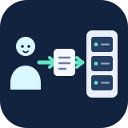

# Compute Relay

Let Codex, Claude Code and other local MCP clients prepare work for your Slurm
clusters. Review the exact job before submission, or set project limits for
automatic execution.

**Development alpha · Python 3.12 or 3.13**

## Quick start

Install from this repository and start the local portal:

```sh
python -m venv ~/.venvs/compute-relay
. ~/.venvs/compute-relay/bin/activate
python -m pip install git+https://github.com/schmitfe/compute-relay.git
compute-relay
```

The launcher opens `http://127.0.0.1:8768`. In the portal, add your cluster and
start its connector. Choose your SSH identity and answer passphrase or MFA
prompts in the terminal. Then select an environment, create a project, set its
approval and compute limits, and create a project key.

In your science project directory, connect your clients:

```sh
compute-relay init-mcp --client both --with-workflow
```

Enter the project key at the hidden prompt. The command creates project-local
Codex and Claude Code settings; it does not copy SSH credentials into them.
Ask your client to prepare a job. Review the generated script and approve it in
the portal before it is submitted. See [client setup](docs/local-client-setup.md)
for more options.

The portal, SQLite ledger and connectors run on your device. A submitted Slurm
job continues if you close the portal; restarting `compute-relay` resumes
monitoring. This package shares your operating-system account and does not
isolate credentials from another process running as that account; see the
[security boundary](docs/security.md).

## Documentation

[Installation and recovery](docs/deployment.md) ·
[Runtime and limits](docs/runtime.md) ·
[Portal](docs/management.md) ·
[Architecture](docs/architecture.md) ·
[Modules](docs/extensions.md) ·
[Testing](docs/testing.md) ·
[Documentation guide](docs/README.md) ·
[Prioritized roadmap](docs/roadmap.md)

## Development

From a source checkout, install the test extra and run the core checks:

```sh
python -m pip install -c requirements.lock '.[test]'
python -m pytest -q
python tools/check_contracts.py
python tools/local_smoke.py
```

The default suite uses SQLite and synthetic credentials; it does not contact a
real cluster. See [optional Slurm acceptance](docs/container-testing.md).

## License

Apache-2.0. The intended PyPI distribution is not published yet.
