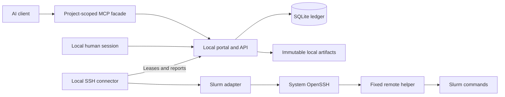
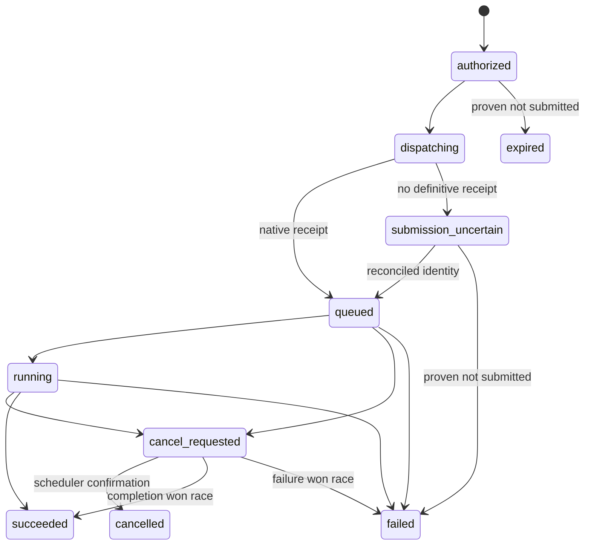

# Architecture

Developer overview of the local control service, connector and job lifecycle.
Operational limits are in [runtime](runtime.md); the [ADRs](adr/README.md) record
why these boundaries exist.

## Components

The foreground launcher supervises the portal and installation-owned connectors.
Control owns approvals, admission, storage authorization and accounting. A
connector holds SSH access and durable submission journals, with no controller
database access. The local stdio facade holds only a project credential; the
agent client runs its own orchestration loop. Jobs survive their originating chat.
Components share one OS account; see the [security boundary](security.md).

## Execution backends and remote components

`create_backend(connection)` in `backends/registry.py` selects fixed Slurm or fake
implementations, defaulting to Slurm. Unknown identifiers fail; configuration
cannot supply imports or registrations. Fake execution never runs uploaded code.

Remote components use standard-library imports and a fixed installed allowlist.
`remote/bundles.py` checks providers, exports and cycles, then links deterministic
job and discovery bundles. No broker-package import or request-selected module
runs remotely. New submissions bind the exact execution-helper hash. Compatible
management uses current reviewed helper code with the original manifest, journal,
native identity and derived attempt directory; stored helper source is never run.

Another scheduler requires a concrete deployment need, configuration validation,
exact-package tests, identity/reconciliation, cancellation and final accounting.
It cannot change approval or spending authority. Record an ADR after disposable
and permitted site acceptance.

## Job preparation and human review

A `Job` freezes uploaded or authorized artifact inputs, a cluster-bound environment,
resources, generated batch script and environment wrapper. File SHA-256 hashes
and an RFC 8785 canonical manifest bind the exact reviewed content and connection
revision. The manifest excludes its own digest and sorts unique logical paths.
A changed source, target, environment or allocation requires a new revision.
Preparation stages inert bytes; it does not execute payloads or install packages.

An `ExecutionRequest` uses human approval or the project's automatic envelope.
One decision authorizes one request and attempt; it cannot approve later repeats.
Admission rechecks key/project/cluster policy, revisions, effective allocation,
funds and active/lifetime limits, then reserves compute and creates the attempt
atomically. Mixed-mode and GPU permissions are configured in the
[portal](management.md#projects-and-job-policy). Exact input and reservation
rules live with the [contracts](../contracts/README.md).

## Lifecycle and uncertain submission

Execution, accounting, collection and connection health are separate states.
Native observations can skip intermediate states. Journal intent before `sbatch`;
a lost reply or expired lease reconciles the same attempt rather than resubmitting.
Native identity includes connection, cluster, remote user, job ID and submit time:
a reused Slurm number alone is insufficient. Exactly-once Slurm execution is not
promised; uncertain submission or usage keeps the reservation.

## Budget units and transactions

Use allocated CPU-core-seconds and GPU-device-seconds, not utilization or billing
TRES. Reserve effective allocation × requested walltime; settle actual usage in
full, including overages/debt. Failed and cancelled allocations are charged too.
Do not double-count `.batch`/`.extern` steps. Missing or ambiguous final accounting
preserves the claim; cancellation acknowledgement alone is not a refund.

| Transition | Atomic database changes |
| --- | --- |
| Authorize | Check current authority/capacity, consume approval/lifetime slot, reserve funds and create attempt |
| Dispatch | Confirm current lease/permit and record intent before external submission |
| Settle | Record actual usage once and remove its reservation |
| Release | Require proof of no submission or definitive zero-allocation outcome |
| Adjust | Append a privileged correction with original evidence and actor/reason |
| Pause/revoke | Block new admission/dispatch while retaining committed usage and evidence |

SQLite `IMMEDIATE` transactions, uniqueness constraints and generation checks
serialize clients and workers. Network operations and file publication stay
outside write transactions. Grant expiry is an admission cutoff; submitted jobs
keep their original grant. A replacement grant cannot free old reservations.

## Worker and storage boundaries

Workers receive typed, bounded, generation-fenced online leases for assigned
connections. Dispatch needs current controller confirmation; cached allowances
never authorize offline spending. Management remains possible after the agent
key is revoked. Collection and report replay use durable terminal evidence;
[worker recovery](async-workers.md) defines their concurrency and lease rules.

Input/output hashes identify content, not access rights. Control authorizes
references and downloads, reserves local storage before writes and protects
unsettled evidence from cleanup. The worker relays declared outputs into the
broker store; direct/object-store delivery is unsupported. Publication and input
provenance are described once in [security](security.md#input-provenance-and-object-publication).
Follow [deployment](deployment.md#stop-restart-and-back-up) for coordinated backups.

Optional apps own their models, migrations and policies and submit through this
same lifecycle. The core remains usable without them; their integration contract
is in [extensions](extensions.md).
