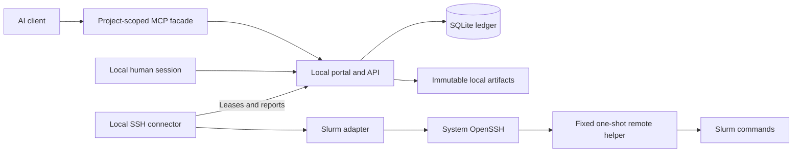
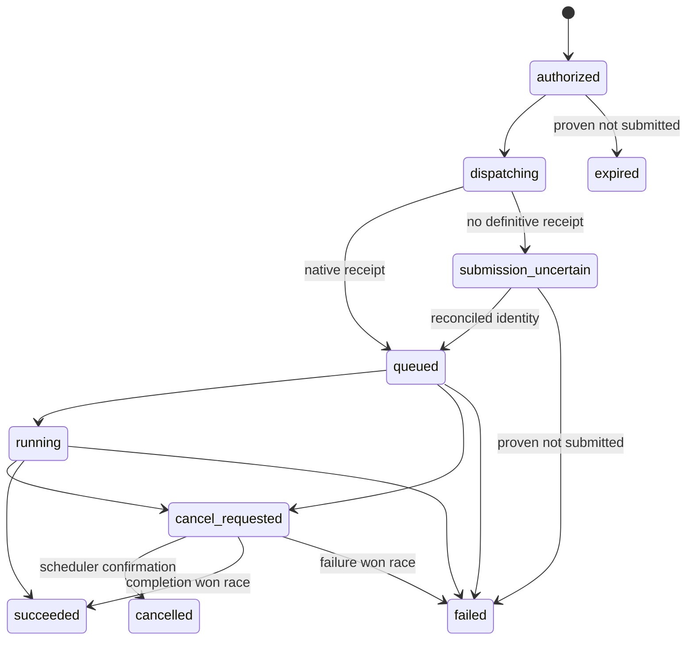

# Compute Relay architecture

This describes the local package and its execution boundaries. See [runtime](runtime.md)
for supported behavior and [installation](deployment.md) for startup and recovery.
The prior hosted/multi-user design is archived on `codex/archive-multi-user-server`
at `520effc`.

## Local scope

One command starts a loopback Django/Waitress portal, a durable SQLite ledger,
local artifact storage and saved SSH connectors. One local owner controls
projects, cluster profiles and human decisions, using an optional password or
explicitly selected passwordless local access. All components share the device's
ordinary account; they do not form an operating-system secret boundary against
another process with that account's access.

The broker supplies compute access to existing AI clients; it does not run the
language-model orchestration loop. A durable job survives its originating chat.
Independent clusters retain separate SSH identities and human login/MFA sessions.
Failure of one connection must not erase another's records or accounting.

## Components



The launcher supervises the web service and saved connectors. SSH passphrase and
MFA prompts remain in its terminal and are serialized. Connectors use scoped
HTTP credentials and their own durable journals rather than accessing controller
tables directly. The official MCP stdio process has a project credential; it
receives no SSH key or MFA response. No Redis, Celery, directory service or
separate database is required.

## Authority

The owner controls all local projects. A project's agent keys have explicit
scopes, expiries and execution policy; several keys share one authoritative
allowance and lifetime submission cap. Key material is shown once and stored as
a hash by the controller. Human configuration and approval remain separate from
project bearer authentication, including in passwordless mode.

A cluster connection binds the local owner, connector, SSH target and approved
Slurm accounts. Agent keys cannot replace its host, user, key path or account
allowlist. A prepared job binds an exact connection/environment revision and
content digest. Revocation or policy change stops new admission and undispatched
execution; observation and accounting of dispatched allocations continue.
Multiple projects using one remote Unix account do not gain filesystem isolation.

## Persisted entities

| Entity | Key fields and constraints |
| --- | --- |
| Local owner | UUID; optional local password hash and saved local authentication choice |
| Project | UUID; local owner, policy, cluster/environment grants and shared key limits |
| ProjectCredential | Project, creator, actor label, secret hash, independent display identifier, scopes, expiry, execution confirmation, cluster restrictions, revocation |
| Cluster and ClusterProfileRevision | Backend kind; immutable normalized discovery and raw observation references; timestamps; admin overrides |
| ClusterConnection | Owner, cluster, worker, remote identity, credential reference, allowed accounts, authorization state |
| EnvironmentRevision | Immutable named execution recipe, exact connection binding, files/digest and optional published build reference |
| EnvironmentSpec / EnvironmentBuild / EnvironmentArtifact | Project/connection-scoped definition and lock; ordinary charged build attempt; published runtime generation and provenance |
| WorkflowRevision / WorkflowRun / WorkflowNodeRun | Immutable bounded graph and artifact edges; durable activation, concrete jobs and retry history |
| Job and JobRevision | Project, requester, immutable request, revision number, manifest digest, prepared profile/environment/connection revisions |
| ExecutionRequest and ApprovalDecision | Request binds revision/digest; human decision binds one execution request and one permitted attempt, approver, comment and timestamp; unique consumption, never overwritten |
| BudgetGrant | Project, authorization interval, policy version, CPU/GPU limits and counters, admission state |
| Reservation | Grant, attempt, maximum charge vector, state; one open reservation per attempt |
| LedgerEntry | Append-only reserve, settle, release, adjustment or overage; unique idempotency identity |
| JobAttempt | Revision, reservation, worker, submission UUID, native identity, lifecycle state and observations |
| WorkItem | Typed operation, attempt, lease owner/expiry, generation, attempts; durable outbox |
| Artifact | Project, attempt/revision, logical path, content digest, size, media type, retention and visibility |
| StorageQuota and UploadReservation | Project/global byte and object limits, in-flight reservations, upload expiry; atomic accounting before writes |
| StoragePool / StorageTarget / ProjectStoragePolicy / StorageObservation | Backing filesystem identity; protected connection/root/capabilities; advisory project byte/inode budgets and placement; timestamped filesystem/quota measurements |
| ArtifactReplica / StorageHold | Digest-bound location/receipt; advisory peak-space estimate, target, expiry and consuming attempt |
| AuditEvent | Actor, project, action, object, decision, timestamp, request ID; no credential contents |

Use database foreign keys and uniqueness constraints in addition to application validation. The control database stores credential references rather than cluster private keys. Protect backups of the database and objects as service data; project tokens are hashed, while privileged service keys are stored separately.

The native job identity includes connection, cluster identity, remote user, scheduler job ID and submit timestamp. A job number alone is not globally unique and can be reused. Record restart/requeue observations separately rather than rewriting a previous accounting observation.

## Job preparation and human review

1. An authorized client uploads individual content-addressed files. Version one has no ZIP/tar import and no arbitrary local or remote file paths.
2. The client creates an immutable request referencing a permitted connection, a pinned named environment, input descriptors, command and bounded resources.
3. Preparation validates authorization, capability freshness and site restrictions. The worker/helper may inspect metadata and stage inert bytes, but must not execute payload code or install packages before authorization.
4. The adapter renders the final `sbatch` bytes and environment wrapper. The service stores the complete manifest and files. It calculates maximum allocation and compute reservation requirements from the configured site model, not from an LLM estimate.
5. The UI shows script files, wrappers, environment revision, resource/allocation envelope, data access, maximum charge, and the diff from earlier revisions. A human decision binds the canonical manifest digest.
6. Approval-required execution requests wait. A human approval permits exactly one attempt for that request in version one; it is consumed atomically at authorization and cannot be replayed for another attempt, even with the same package digest. Budgeted requests pass a fresh deterministic policy check and reservation for each attempt. Mixed mode uses the budgeted path only within the configured automatic envelope; otherwise it creates a human approval request. Hard project/installation caps still apply after human approval. A cap increase is a separate authorized policy change.
7. Authorization rechecks permissions, credential status, pause state, policy version, immutable connection revision, profile compatibility, active-job cap and funds. Apply the automatic envelope and hard caps to the effective prepared allocation after site rounding and requested walltime, not only the unrounded resource request. It reserves compute and creates a dispatch outbox item in the same transaction.

Package integrity uses SHA-256 of each file and an RFC 8785 canonical JSON manifest. The manifest excludes its own digest. File entries are sorted by logical path before canonicalization; duplicate paths are invalid. It includes the exact batch script, environment wrapper, referenced immutable environment recipe/image digest, resource envelope, immutable connection-configuration digest and profile revision. Reject duplicate JSON keys, nonfinite numbers and unpaired Unicode surrogates before validation/hashing. Restrict wire integers to the exact browser/JSON range through `2^53 - 1`; the internal ledger uses checked BIGINT arithmetic. Mutable input datasets are identified as mutable in the review; a pinned reference is not proof of their future contents. Hard reproducibility requires snapshots/checksums and isolated execution.

The worker verifies file bytes against the manifest before transfer and invokes submission for the exact staged bytes. Revisions and decisions are immutable. A changed script, environment, target or allocation creates a new revision. Site changes affecting submitted bytes or maximum allocation require re-preparation. [RFC 8785](https://www.rfc-editor.org/rfc/rfc8785)

## Lifecycle and uncertain submission

Store preparation/approval state separately from execution and accounting. An execution state cannot, by itself, release a reservation.



Native observations can skip transient states, for example queued directly to succeeded. Connection authentication is a separate `disconnected`, `authenticating`, `ready`, `auth_required`, `disabled`, or `revoked` state. `disabled` is an administrative pause; `revoked` permanently invalidates the connection identity. An MFA outage does not mean a batch job failed. `submission_uncertain` and missing accounting block settlement and keep funds reserved.

Slurm does not supply a broker-wide exactly-once submit transaction. Persist a submission UUID, lease generation, pre-submit intent, and native metadata before/after submission. Use the UUID in supported scheduler metadata and the private remote attempt record. If submission may have reached Slurm, do not submit again automatically. Reconcile using owned active/accounting records and exact native identity. If no unique conclusion is possible, quarantine for an operator. A lease expiring never authorizes a second `sbatch` while the first result is uncertain. At-most-once broker intent plus reconciliation is the target; exactly-once Slurm execution is not promised.

## Budget units and transactions

Use integer allocated resource-seconds: `cpu_core_seconds` and `gpu_device_seconds`. Requested utilization, process CPU time, GPU busy percentage and billing TRES are different quantities. Requested Slurm limits are whole-minute multiples in version one. Reserve effective allocated resources multiplied by requested walltime: 8 cores and 1 GPU for 3,600 seconds reserve 28,800 core-seconds and 3,600 GPU-seconds. No termination, overtime or cleanup interval is added. Requested walltime is the sole reservation duration; no separate charge-duration field is retained. Settlement charges actual Slurm-reported elapsed allocated resources in full, even when usage exceeds the reservation; debt blocks new admissions. This reservation model does not promise a physical upper bound on site usage. Separate GPU-type buckets or explicit weights are later features; initially each grant has an allowed GPU-type set so dissimilar devices are not silently treated as equivalent. [Slurm time-limit behavior](https://slurm.schedmd.com/sbatch.html)

The admission invariant for each resource dimension is:

```text
spent + reserved + candidate_reservation <= granted_limit
```

| Operation | Required atomic behavior |
| --- | --- |
| Authorize | Check policy and active count; increase reserved vector; insert reservation and ledger entry; create attempt and outbox item; commit together |
| Dispatch | Lease work and confirm current permit; record intent before external submit; perform no network I/O while holding ledger locks |
| Settle | Require final native allocation/runtime evidence; decrease reservation; increase spent by actual allocated usage; insert one settlement and mark settled together |
| Release | Only with proof no submission occurred, or final zero-allocation cancellation; record reason and unique release event |
| Adjustment | Privileged append-only correction; retain original evidence and record actor/reason |
| Pause or revoke grant | Block future admissions/dispatch permits; preserve records and committed usage; cancellation is an explicit operation |

Serialize authorization with SQLite `IMMEDIATE` write transactions and short bounded retries for lock contention. The local database remains authoritative across worker processes and API clients. Check the active-job cap in the same serialized transaction. Enforce unique settlement/release constraints and optimistic lease generation checks. Do not implement concurrency solely with process-local locks. [Django database differences](https://docs.djangoproject.com/en/5.2/ref/databases/)

Keep full reservations for queued/running attempts. Account failed and cancelled jobs for allocated runtime too. Do not double-count allocation and `.batch`/`.extern` step records. Missing final allocation, a native requeue or unverifiable final usage quarantines the attempt, blocks further automatic spending as appropriate, and preserves its reservation. Usable final accounting is charged in full even if allocated resources or elapsed duration exceeded the prepared reservation; record the overage rather than truncating observed usage to fit the grant.

Grant expiry is an admission/dispatch cutoff. Already submitted jobs may finish afterward within their committed envelope; their usage stays with the original grant. A replacement grant never frees old reservations. An approval does not guarantee future capacity or funding: if admission fails it remains unexecuted with a structured explanation. Retrying an execution is a new attempt requiring new authorization and funds. No automatic retries, arrays, multi-node jobs, user-controlled requeue, exclusive allocation, or allocation resizing in the first release.

Admission needs finite requested walltime and a supported allocation model. A cluster that rounds requests up or adds resources needs tested allocation rules so the reservation reflects those resources. Actual elapsed allocation may exceed requested walltime; settlement records all usable final usage rather than imposing the reservation as a charge cap. A site with unavailable final accounting may use human review with an explicit conservative settlement against the reserved amount; it cannot enable unattended actual-usage budgeting. Broker-only controls cannot bound malicious same-UID nested jobs or scheduler modifications; see the security model.

## Worker protocol and execution grants

Workers authenticate independently from users/project keys. A worker is assigned connection IDs and typed operations. It cannot change budgets, approve requests, resolve arbitrary secret references, or access the database. It pulls leased work over a Unix socket/private HTTPS endpoint and reports bounded observations; it does not expose an agent-facing remote shell.

An execution permit binds attempt UUID, submission UUID, reservation UUID, worker and connection IDs, immutable connection-configuration digest, manifest digest, resource envelope, policy/grant generation, operation, issuance/expiry and a nonce. Initial permits travel over an authenticated protected local channel or mutually authenticated HTTPS; the worker verifies them online. The worker persists consumed nonce/submission records outside agent control. Signed envelopes are an optional later defense for relays, not a prerequisite or permission for offline spending. Any later signature must use a vetted standard implementation; the durable attempt record and dispatch handshake must still authorize the current generation.

A worker must obtain a current dispatch confirmation before a new external submission. Offline connectors do not spend from cached allowances. Once `sbatch` may have happened, an expired permit leads to reconciliation, not fresh dispatch. Separate narrow permits cover status, accounting and cancellation; these remain available after agent-key revocation so the service can manage existing jobs.

## Storage and recovery

Use protected content-addressed local files with a storage interface that can later support S3. Authorize every download; possession of a digest or guessed path is not permission. Logical artifact paths resolve only under their attempt root. Serve HTML/SVG or unknown content as attachments unless a sandboxed preview is deliberately implemented. Broker secrets are never staged onto a cluster or injected into job environments.

Enforce per-project and global storage/object-count quotas, concurrent-upload limits and a disk-headroom floor. Reserve declared or chunked upload capacity transactionally before writing bytes, then reconcile actual bytes. Count logical project references separately from physical deduplicated objects without disclosing another project's content. Aborted uploads expire; unreachable objects have a bounded orphan TTL. Artifact collection consumes the same quotas. Garbage collection never removes evidence/packages held by unsettled attempts. Per-file/package limits alone are not sufficient against storage exhaustion.

After a restart, replay outstanding work by state and lease generation, reconcile dispatched native jobs, and settle only after definitive evidence. Back up the database, objects, protected keys and configuration with a coordinated procedure. A stale restore can forget already submitted jobs; restore starts with admissions paused and remote reconciliation before resuming. Never restore a second installation that admits work against the same outstanding jobs without one authoritative ledger and reconciliation fence.

### Planned project storage guidance and placement

This extension is **not implemented** by the current broker object-store quotas. Those quotas bound uploaded/relayed objects; they do not measure or constrain cluster files, installed environments, shared NAS usage or parallel-filesystem quotas.

Treat three different observations separately: a project planning budget, a remote user/group/project filesystem quota, and free capacity of the underlying shared filesystem. A project can remain below its planning budget while other users exhaust the filesystem. Conversely, a large filesystem can have free space while a particular user has exhausted a byte or inode quota.

An operator enrolls named `StorageTarget` records under protected connection-specific roots, each attached to a `StoragePool`. Capabilities include shared versus node-local visibility, persistence/retention, expected filesystem identity, available quota adapter, supported environment representations, scratch provisioning and transfer routes. Humans select narrower project subdirectories and assign roles such as `work`, `environments`, `results` and `scratch`. Agents select a permitted target ID and relative logical path; they cannot supply a new hostname, credential, unrestricted absolute path or mount option. Several directories on the same backing filesystem share one capacity observation rather than appearing to have independent free pools. A missing mount or changed filesystem identity cannot silently fall back to the underlying local directory.

`ProjectStoragePolicy` contains per-target advisory byte and inode/file-count budgets, retention preferences, permitted result destinations and environment representations. Byte budgets need an explicit unit in the UI; inode limits include directory and other counted objects, not merely regular files. Existing project compute policy remains independent. At first, crossing a project storage budget yields a structured warning and estimate; it is not advertised as a filesystem-enforced quota. A later optional broker admission limit can reject new managed writes, but cannot constrain arbitrary writes from a job or another remote session without site-enforced quotas.

The agent-facing planning response should contain configured budget, managed measured/estimated usage, outstanding storage holds, proposed peak growth, remaining advisory amount, physical filesystem available bytes/inodes, actual quota remaining where known, observation time, source, completeness and warning state. Unknown values are `null` with a reason, never zero or a fabricated free amount. `statvfs` user-available capacity is not a substitute for a parallel-filesystem user/group/project quota query. Use optional site-specific quota adapters; quota facts retain their scope. An estimate or metadata scan must not be labelled an exact enforced measurement.

Cheap filesystem capacity observations run through fixed worker operations on approved targets. Project usage can combine managed artifact/build receipts with bounded, infrequent scans of its dedicated roots. Never repeatedly walk a multi-terabyte shared home tree on login nodes. Record partial scans and out-of-band writes as uncertainty. Paths, stale observations and scheduler resource tables do not imply current available space.

For a shared NAS hosting identity and home services, recommend an operator-configured low-space admission guard independent of project budgets. Its free-byte and free-inode warning/stop thresholds, reserved headroom, maximum observation age and recovery hysteresis are configurable per backing filesystem. A stale/unreachable observation can pause new storage-heavy managed work according to policy. This is an optional broker guard, not protection against all NAS writers. Do not automatically delete unrelated data, cancel existing jobs or claim a capacity guarantee. Keep the local database, worker journals, monitoring and recovery configuration on storage independent of the vulnerable NAS.

Storage holds reserve **planning estimates**, not physical filesystem blocks. Include build/download caches, unpacked environments, stage-in copies, expected retained outputs and simultaneous old/new migration copies. Declare persistent and peak scratch requirements separately. Deduplicate shared environment-cache estimates at the actual target, while retaining project attribution and access checks. Atomic holds prevent cooperating broker clients from double-planning the same headroom; measurement freshness and external writers still limit the guarantee. Estimate global headroom from observed available capacity minus pending unmaterialized growth and operational reserve; retained files are already reflected in filesystem free space and must not be subtracted twice. A retained result remains charged to project storage planning after compute accounting has settled.

### Planned environment representations and migration

Environment definition, runtime representation and artifact location are separate concepts. A cluster-specific environment may be represented by a stable directory, a relocatable archive or a read-only image according to site capability and the selected storage target.

| Representation | Placement and execution | Constraints |
| --- | --- | --- |
| Stable environment directory | Persistent approved shared prefix; jobs reuse the exact generation | Simple module + venv/Conda baseline, but consumes many shared inodes; do not move a completed venv prefix |
| Packed Conda environment | Keep a digest-bound archive on shared storage; copy, verify, unpack and relocate in bounded node-local scratch | Requires a tested compatible pack/unpack toolchain and platform; include unpacked peak bytes/inodes and startup time |
| Read-only Apptainer SIF | Keep a single versioned image on shared storage; execute at stable internal paths, optionally after copying to node-local cache | Requires site-approved runtime/mount/GPU capabilities; image creation is a charged build job |
| Writable filesystem image/overlay | Optional private per-job copy over a read-only base | Never mount one writable filesystem image concurrently across array tasks; sparse/apparent bytes, internal inode capacity and site support must be explicit |

Python documents virtual environments as non-portable; build a directory generation at its final prefix and publish the ready reference atomically, rather than renaming it after installation. A generic tar archive does not fix relocation. Conda-pack implements explicit prefix relocation and documents platform and post-unpack constraints. Apptainer's normal SIF format is compressed/read-only; writable data belongs on explicit outputs or private scratch rather than in a shared runtime image. [Python venv](https://docs.python.org/3/library/venv.html), [Conda-pack](https://conda.github.io/conda-pack/), [Apptainer build formats](https://apptainer.org/docs/user/latest/build_a_container.html)

An image/archive reduces shared file-count pressure; it does not exempt its bytes from capacity or quota planning. Default caches, temporary files and bytecode writes should target authorized scratch, not a home directory. Many concurrent array elements should use a bounded per-node environment cache with single-writer publication and reference pins, rather than all unpacking onto shared storage or racing on one writable prefix. Scratch exhaustion is a separate failure from shared-storage exhaustion. Retained output bundles can reduce shared small-file counts, with a separate bundle per producer/task and an explicit later aggregation job when needed.

Logical artifacts refer to one or more `ArtifactReplica` locations rather than embedding one permanent directory in downstream job definitions. Same-cluster DAG edges can reuse an authorized remote replica without routing bytes through the broker; cross-target/cluster edges use the approved transport routes below. Migration copies into a new unadvertised generation, verifies its digest/size and expected structure, publishes the replica reference, then retires the old copy only after pins and retention permit. Directory environments require rebuild or a tested relocation-aware representation; never silently move them. Peak-space checks account for both copies. Archive extraction must reject traversal, link/special-file escapes and excessive expanded bytes/inodes before publication. Cleanup and eviction use service-derived identities and cannot delete active environment/result pins.

### Planned reusable environments and workflows

Agents propose a project/cluster-scoped `EnvironmentSpec` containing an allowed base recipe, ordered exact module stack, manager/tool version, dependency lock and package-byte digests, target platform, representation, storage target and compute/storage bounds. An `EnvironmentBuild` links this specification to ordinary prepared jobs and attempts. Resolution, installation, package build hooks and validation execute only inside an authorized compute allocation or an explicitly isolated credential-free builder. A credential-bearing worker stages sealed inputs and reads bounded receipts; it never runs the new interpreter or package installer.

Start with `venv` plus a fully pinned, hashed wheel closure, then add Conda/micromamba explicit locks and Poetry project locks as renderer plugins. Conda/mamba selects the requested Python inside its own solved environment; it does not need to layer another selected module Python beneath it. Source builds, private package credentials and cross-platform portability require separate support. A raw package-manager options/requirements file is not a safe substitute for a validated structured specification. Package resolution may itself invoke build metadata hooks, so it is not a privileged control/worker operation. Online versus offline acquisition is explicit; a credential-free package fetcher or compute build can stage sealed package bytes, with configurable relay/direct transfer. [pip secure installs](https://pip.pypa.io/en/stable/topics/secure-installs/), [pip build interface](https://pip.pypa.io/en/stable/reference/build-system/)

Lifecycle: `draft → prepared → awaiting_approval/authorized → building → validating → ready`, with failed, uncertain, quarantined and retired outcomes. Publish an ordinary immutable execution recipe only after the expected generation and validation receipt are finalized. Reuse is project/connection/identity/platform scoped, keyed by base recipe, lock/package hashes, manager/builder version and ABI/compiler/CUDA compatibility. A successful build does not automatically broaden project environment grants: a human grant or an explicit policy allowing constrained project-built environments is required. Same remote UID owners can mutate directory contents despite hashes and chmod; record managed provenance and mutation detection without claiming hostile immutability.

A static `WorkflowRevision` defines named job/build nodes and success-only artifact edges. Each edge pins a producer node/attempt and declared output to a consumer logical input. A durable dispatcher activates a node only when dependencies succeeded and required artifacts were finalized; it resolves actual digests, prepares a concrete job and calls normal admission. Missing outputs block downstream work even if the scheduler reported success. Cycles, unbounded fan-out and control-side Python expressions are rejected. Explicit retries create new charged attempts and pin the chosen upstream results.

Initial review remains per concrete prepared job. Existing exact-manifest approval cannot silently authorize later generated scripts or unknown input/environment digests. Automatic project/key policy can admit eligible nodes within current limits. A later `WorkflowApproval` can bind a sealed graph/template, permitted late-bound artifact edges and aggregate ceilings, but requires a distinct derivation contract and tests. Reserve compute per admitted ready node initially; this can pause a graph when funds run out. Guaranteed whole-workflow funding needs an aggregate hold transferred to node reservations without double charging.

Native arrays are a separate backend milestone. Add immutable `admission_units` to attempts (existing attempts default to one), typed bounded index sets and `ArrayTask` observations keyed by attempt/index. Reserve the sum of all elements' maximum allocations/durations and count every element against lifetime submissions. Initially count every unsettled element against the existing queued-plus-running active cap; `%K` throttles the array but is not a reduction in total budget/cardinality. Keep one parent submission journal, collect per-element final usage without double-counting aggregate/step records, and retain reservations for missing/uncertain elements. Use unique working/output/log paths per task. Retry subsets as new admitted attempts. Broker-managed DAGs work across clusters; native `afterok`/`aftercorr` can be a later same-cluster optimization after preserving authorization and artifact readiness. [Slurm arrays](https://slurm.schedmd.com/job_array.html), [Slurm dependencies](https://slurm.schedmd.com/sbatch.html)

### Artifact delivery routes: implemented relay and planned selection

The current alpha implements **broker relay only**: the protected worker reads bounded declared outputs over its configured cluster connection, reports their bytes to control, and control stores them under project quotas. The authorized analysis client downloads those stored artifacts from the broker. Logs use the same bounded reporting path. Direct delivery, route selection, transfer grants and object-store delivery described below are planned extensions; they are not current configuration fields or implemented endpoints. The supervised lab test keeps its existing helper, execution manifests and relay flow.

Keep artifact authorization in the control service while allowing the artifact bytes to take a different path. This permits a future transfer adapter to manage jobs without carrying large analysis datasets. The initial extension needs a route selector, a small durable transfer record and an artifact-only transport adapter, rather than a separate workflow platform.

| Planned delivery | Data path | Preconditions |
| --- | --- | --- |
| `direct` | Cluster transfer endpoint → authorized analysis client; bytes bypass worker/control storage | A site-approved artifact endpoint reachable by the client and capable of enforcing broker-scoped grants; cluster SSH credentials are not delegated to the client |
| `relay` | Cluster → protected worker → broker storage → authorized client | Current implemented path; connection authentication and broker storage/transfer quotas remain available |
| Optional `object_store` | Cluster → approved HTTPS object store → authorized client; bytes bypass control | A separately enabled destination and cluster outbound HTTPS access; bounded object-specific upload/download authority and object expiry |

Prefer a client-initiated HTTPS download for direct delivery so the analysis client need not expose an inbound port. A site may configure a different supported artifact transport, but it must meet the same authorization and integrity contract. Ordinary SSH-only enrollment does not create a direct endpoint: until a site supplies an approved artifact endpoint/adapter, that connection advertises relay alone. Never hand the broker's SSH private key, SSH-agent socket, multiplexing socket or human MFA session to the analysis client to manufacture a direct route.

Configure installation-approved capabilities per connection and a narrower delivery preference per project. The effective routes are their intersection; a project/agent cannot add an endpoint or broaden connection policy. The planned preference modes are:

| Mode | Selection behavior |
| --- | --- |
| `direct` | Use the configured direct route or return a structured unavailable/blocked result |
| `relay` | Use broker relay or return a structured unavailable/quota result |
| `auto` | Try the explicitly configured preferred route, then only the explicitly listed fallback routes that policy permits |

For example, a future project preference `{"mode":"auto","preferred_route":"direct","fallback_routes":["relay"]}` permits relay when the direct endpoint is blocked by the firewall. An empty fallback list permits no fallback. `auto` never means probing arbitrary ports, starting a tunnel, changing destination, or silently moving sensitive data through the broker or another service. When the optional object-store route is introduced, it must be an explicit permitted selection/fallback with a configured destination ID; `auto` alone never enables it. Record the chosen route, configured endpoint ID, policy revision and fallback reason, and make them visible to the requesting client.

For each completed output, retain a control-plane artifact descriptor containing project, attempt/revision, declared logical path, size, SHA-256, source receipt/version and retention state. A future fixed backend operation obtains this metadata without sending file bytes through control; it must respect site limits on hashing large files. Before issuing a transfer grant, recheck project membership/key scope, artifact visibility, route policy, endpoint capability and byte/concurrency limits. A transfer is a separate authorization record: it does not alter the approved execution package, resubmit the job, release compute reservations or change final accounting. Any scheduled preparation/transfer workload needs its own authorized attempt and allowance.

An artifact-only grant binds one descriptor/digest, project and attempt, named source and destination endpoint IDs, operation, client audience, maximum bytes, expiry, policy generation and nonce. Use an opaque online-redeemed grant initially; signatures are optional if a future endpoint requires them. The endpoint and client authenticate independently. Enforce redemption/concurrency/byte limits across retries and range requests, and check revocation before a new redemption. Neither a project key nor a transfer grant permits directory listing, arbitrary paths, job execution or access to another artifact. Transfer tokens are short-lived secrets, redacted from logs and model context unless the analysis client explicitly needs its own scoped download capability; they convey no SSH/MFA or service-administration authority.

The destination verifies size and SHA-256 before marking a download complete and acknowledges the descriptor digest to control. A mismatch quarantines the result and leaves the transfer failed; it never silently rewrites the expected digest. A changed remote output requires a new artifact version/receipt and fresh authorization. A lost acknowledgement may leave delivery status unknown even though bytes arrived; it never triggers a new compute job. Direct delivery saves metadata and receipts in control without copying the bytes into broker storage. Retention, byte quotas and audit records apply to the systems that actually hold the data; direct delivery does not claim the broker has a backup.

Endpoints are installation-owned references, not URLs supplied by an agent. Resolve destinations from protected configuration and verify scheme, host, port and TLS identity. Disable redirects or revalidate every hop against the same allowlist; constrain network egress and DNS resolution so endpoints cannot become SSRF paths into local, metadata or unrelated private services. Apply equivalent checks to object-store uploads and downloads. If only outbound HTTPS is allowed from the cluster, a future object-store adapter can upload one approved object using a short-lived upload grant and let the client fetch it independently; no long-lived cloud credential is staged into workload code.

Planned acceptance tests cover direct delivery with zero broker artifact bytes; firewall-blocked direct transfer with and without explicit relay fallback; relay quota exhaustion; expired/revoked/wrong-audience grants; replay and parallel/range-request byte limits; changed files and hash/size mismatches; other-project access denial; unapproved hosts, redirects and DNS rebinding; interrupted transfer/resume and lost acknowledgements; and object-store expiry/outbound-only connectivity. These are future route-conformance tests, not evidence of current direct-transfer support.

## Extension boundaries

The backend protocol includes capability discovery, preparation, submission, native reconciliation, status, cancellation, usage and artifact operations. It returns typed snapshots and preserves native fields alongside normalized ones. Unsupported features cause explicit errors rather than ignored options. Slurm REST and FirecREST become alternative Slurm access adapters; HTCondor and Kubernetes implement the backend protocol separately. Each must document allocation units, retry semantics, filesystem scope and billing evidence before budgeted mode is enabled.

Hosted HTTP MCP is a later resource server using standards-compliant OAuth, audience validation and project-scoped authorization. Local stdio MCP is only a client facade using an agent key. Neither receives privileged service credentials. Human OIDC login to the web application is distinct from implementing the MCP resource-server authorization contract. [MCP authorization](https://modelcontextprotocol.io/specification/2025-11-25/basic/authorization), [MCP transports](https://modelcontextprotocol.io/specification/2025-11-25/basic/transports)
