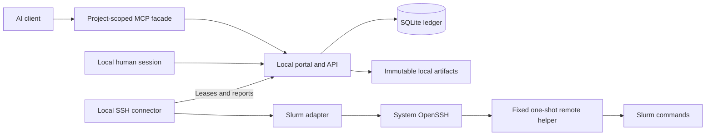
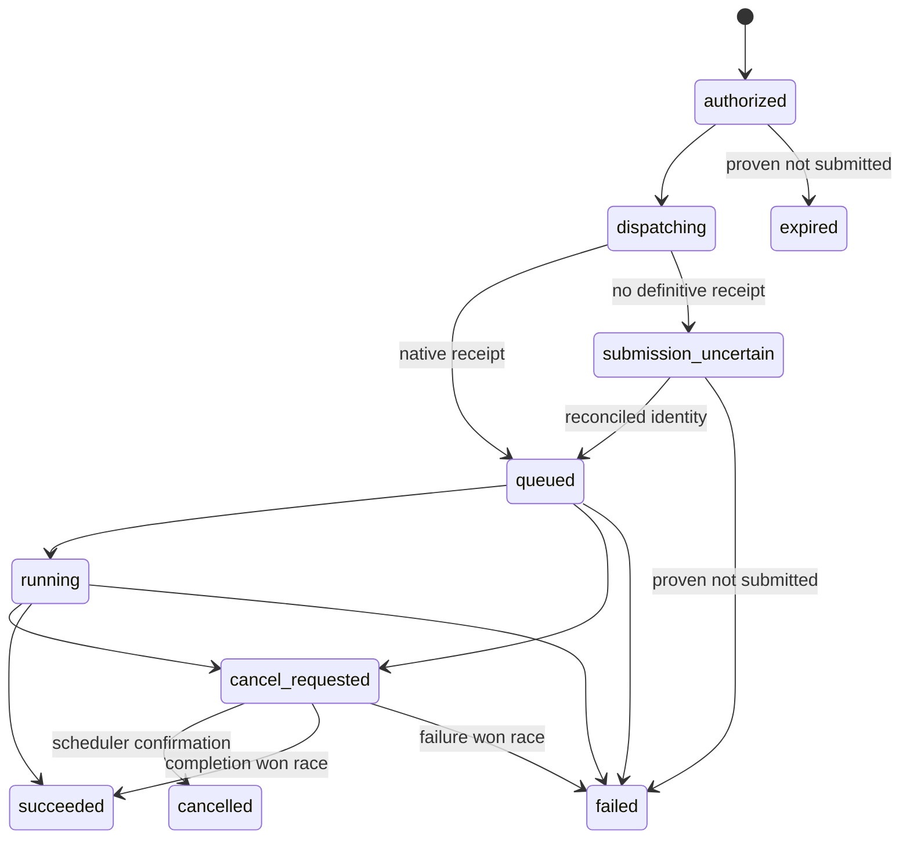

# Compute Relay architecture

This describes the package boundaries and execution flow. See [runtime](runtime.md)
for supported behavior and [installation](deployment.md) for startup and recovery.

## Local scope

One command starts a loopback Django/Waitress portal, a durable SQLite ledger,
local artifact storage and saved SSH connectors. One local owner controls
projects, cluster profiles and human decisions, using an optional password or
explicitly selected passwordless local access. All components share the device's
ordinary account; they do not form an operating-system secret boundary against
another process with that account's access.

The broker supplies compute access to existing AI clients; it does not run the
language-model orchestration loop. A durable job survives its originating chat.
Independent clusters retain separate SSH identities and human login/MFA sessions.
Failure of one connection must not erase another's records or accounting.

## Components



The launcher supervises the web service and saved connectors. SSH passphrase and
MFA prompts remain in its terminal and are serialized. Connectors use scoped
HTTP credentials and their own durable journals rather than accessing controller
tables directly. The official MCP stdio process has a project credential; it
receives no SSH key or MFA response.

## Backend registration and remote components

Workers select their implementation through `backends/registry.py`. Its explicit
registrations pair an identifier with one asynchronous implementation.
The registry rejects duplicate definitions and keeps the factory map
read-only. Configuration selects a registered identifier; it cannot supply an
import path, discover installed entry points or register code through an API.
The current entries are the simulation and native asynchronous Slurm implementations.

This centralizes construction without making backend registration an execution
permission. A future scheduler also needs reviewed configuration validation,
preparation, immutable identity and reconciliation rules, accounting, discovery,
and tests. Slurm-specific checks and simulation-specific behavior remain in
their implementations. Import-time self-registration would add ordering and
startup side effects without removing these requirements, so registration stays
explicit in one bootstrap table.

Remote helper components are normal Python modules with their own standard-
library and relative imports. Shared constants live in `remote/prelude.py`;
bounded software probes live in `remote/probes.py`, avoiding a cycle between
catalog and environment discovery. `remote/bundles.py` reads only its fixed
installed component allowlist, checks imported providers/exports, rejects cycles,
and links components in deterministic dependency order. It removes only the
declared first-party import statements from the transmitted program; standard-
library imports remain explicit. The generated dispatcher is passed to the
entrypoint as an argument.

The remote program still requires only the standard library and runs under the
isolated interpreter. It never imports the broker package, project files or a
module selected by a request on the cluster. Component declarations can be
reordered without changing bundle bytes. Discovery keeps its separate bundle.
Changing execution-helper source requires a new prepared revision for subsequent
submission; compatible management of existing attempts retains its original
identity checks.

## Authority

The owner controls all local projects. A project's agent keys have explicit
scopes, expiries and execution policy; several keys share one authoritative
allowance and lifetime submission cap. Key material is shown once and stored as
a hash by the controller. Human configuration and approval remain separate from
project bearer authentication, including in passwordless mode.

A cluster connection binds the local owner, connector, SSH target and approved
Slurm accounts. Agent keys cannot replace its host, user, key path or account
allowlist. A prepared job binds an exact connection/environment revision and
content digest. Revocation or policy change stops new admission and undispatched
execution; observation and accounting of dispatched allocations continue.
Multiple projects using one remote Unix account do not gain filesystem isolation.

## Persisted entities

| Entity | Key fields and constraints |
| --- | --- |
| Local owner | UUID; optional local password hash and saved local authentication choice |
| Project | UUID; local owner, policy, cluster/environment grants and shared key limits |
| ProjectCredential | Project, creator, actor label, secret hash, independent display identifier, scopes, expiry, execution confirmation, cluster restrictions, revocation |
| Cluster and ClusterProfileRevision | Backend kind; immutable normalized discovery and raw observation references; timestamps; admin overrides |
| ClusterConnection | Owner, cluster, worker, remote identity, credential reference, allowed accounts, authorization state |
| EnvironmentRevision | Immutable named execution recipe, exact connection binding, files/digest and optional published build reference |
| EnvironmentSpec / EnvironmentBuild / EnvironmentArtifact | Project/connection-scoped definition and lock; ordinary charged build attempt; published runtime generation and provenance |
| WorkflowRevision / WorkflowRun / WorkflowNodeRun | Immutable bounded graph and artifact edges; durable activation, concrete jobs and retry history |
| Job and JobRevision | Project, requester, immutable request, revision number, manifest digest, prepared profile/environment/connection revisions |
| ExecutionRequest and ApprovalDecision | Request binds revision/digest; human decision binds one execution request and one permitted attempt, approver, comment and timestamp; unique consumption, never overwritten |
| BudgetGrant | Project, authorization interval, policy version, CPU/GPU limits and counters, admission state |
| Reservation | Grant, attempt, maximum charge vector, state; one open reservation per attempt |
| LedgerEntry | Append-only reserve, settle, release, adjustment or overage; unique idempotency identity |
| JobAttempt | Revision, reservation, worker, submission UUID, native identity, lifecycle state and observations |
| WorkItem | Typed operation, attempt, lease owner/expiry, generation, attempts; durable outbox |
| Artifact | Project, attempt/revision, logical path, content digest, size, media type, retention and visibility |
| StorageQuota and UploadReservation | Project/global byte and object limits, in-flight reservations, upload expiry; atomic accounting before writes |
| StorageCapacityPool / StorageTarget / ProjectStorageBudget / ProjectStorageBinding | Backing filesystem identity; protected connection/root/capabilities; advisory project byte/inode budgets and placement; timestamped filesystem/quota measurements |
| AuditEvent | Actor, project, action, object, decision, timestamp, request ID; no credential contents |

Use database foreign keys and uniqueness constraints in addition to application validation. The control database stores credential references rather than cluster private keys. Protect backups of the database and objects as service data; project tokens are hashed, while privileged service keys are stored separately.

The native job identity includes connection, cluster identity, remote user, scheduler job ID and submit timestamp. A job number alone is not globally unique and can be reused. Record restart/requeue observations separately rather than rewriting a previous accounting observation.

## Job preparation and human review

1. An authorized client uploads individual content-addressed files. Version one has no ZIP/tar import and no arbitrary local or remote file paths.
2. The client creates an immutable request referencing a permitted connection, a pinned named environment, input descriptors, command and bounded resources.
3. Preparation validates authorization, capability freshness and site restrictions. The worker/helper may inspect metadata and stage inert bytes, but must not execute payload code or install packages before authorization.
4. The adapter renders the final `sbatch` bytes and environment wrapper. The service stores the complete manifest and files. It calculates maximum allocation and compute reservation requirements from the configured site model, not from an LLM estimate.
5. The UI shows script files, wrappers, environment revision, resource/allocation envelope, data access, maximum charge, and the diff from earlier revisions. A human decision binds the canonical manifest digest.
6. Approval-required execution requests wait. A human approval permits exactly one attempt for that request in version one; it is consumed atomically at authorization and cannot be replayed for another attempt, even with the same package digest. Budgeted requests pass a fresh deterministic policy check and reservation for each attempt. Mixed mode uses the budgeted path only within the configured automatic envelope; otherwise it creates a human approval request. Hard project/installation caps still apply after human approval. A cap increase is a separate authorized policy change.
7. Authorization rechecks permissions, credential status, pause state, policy version, immutable connection revision, profile compatibility, active-job cap and funds. Apply the automatic envelope and hard caps to the effective prepared allocation after site rounding and requested walltime, not only the unrounded resource request. It reserves compute and creates a dispatch outbox item in the same transaction.

Package integrity uses SHA-256 of each file and an RFC 8785 canonical JSON manifest. The manifest excludes its own digest. File entries are sorted by logical path before canonicalization; duplicate paths are invalid. It includes the exact batch script, environment wrapper, referenced immutable environment recipe/image digest, resource envelope, immutable connection-configuration digest and profile revision. Reject duplicate JSON keys, nonfinite numbers and unpaired Unicode surrogates before validation/hashing. Restrict wire integers to the exact browser/JSON range through `2^53 - 1`; the internal ledger uses checked BIGINT arithmetic. Mutable input datasets are identified as mutable in the review; a pinned reference is not proof of their future contents. Hard reproducibility requires snapshots/checksums and isolated execution.

The worker verifies file bytes against the manifest before transfer and invokes submission for the exact staged bytes. Revisions and decisions are immutable. A changed script, environment, target or allocation creates a new revision. Site changes affecting submitted bytes or maximum allocation require re-preparation. [RFC 8785](https://www.rfc-editor.org/rfc/rfc8785)

## Lifecycle and uncertain submission

Store preparation/approval state separately from execution and accounting. An execution state cannot, by itself, release a reservation.



Native observations can skip transient states, for example queued directly to succeeded. Connection authentication is a separate `disconnected`, `authenticating`, `ready`, `auth_required`, `disabled`, or `revoked` state. `disabled` is an administrative pause; `revoked` permanently invalidates the connection identity. An MFA outage does not mean a batch job failed. `submission_uncertain` and missing accounting block settlement and keep funds reserved.

Slurm does not supply a broker-wide exactly-once submit transaction. Persist a submission UUID, lease generation, pre-submit intent, and native metadata before/after submission. Use the UUID in supported scheduler metadata and the private remote attempt record. If submission may have reached Slurm, do not submit again automatically. Reconcile using owned active/accounting records and exact native identity. If no unique conclusion is possible, quarantine for an operator. A lease expiring never authorizes a second `sbatch` while the first result is uncertain. At-most-once broker intent plus reconciliation is the target; exactly-once Slurm execution is not promised.

## Budget units and transactions

Use integer allocated resource-seconds: `cpu_core_seconds` and `gpu_device_seconds`. Requested utilization, process CPU time, GPU busy percentage and billing TRES are different quantities. Requested Slurm limits are whole-minute multiples in version one. Reserve effective allocated resources multiplied by requested walltime: 8 cores and 1 GPU for 3,600 seconds reserve 28,800 core-seconds and 3,600 GPU-seconds. No termination, overtime or cleanup interval is added. Requested walltime is the sole reservation duration; no separate charge-duration field is retained. Settlement charges actual Slurm-reported elapsed allocated resources in full, even when usage exceeds the reservation; debt blocks new admissions. This reservation model does not promise a physical upper bound on site usage. Separate GPU-type buckets or explicit weights are later features; initially each grant has an allowed GPU-type set so dissimilar devices are not silently treated as equivalent. [Slurm time-limit behavior](https://slurm.schedmd.com/sbatch.html)

Selecting all discovered GPU types can explicitly permit scheduler-chosen GPU
hardware. The project stores this intent separately from its selected type set;
generic requests require current complete partition discovery to remain covered
at admission and dispatch. An empty selection denies GPU use. A partial
selection cannot become generic merely because discovery later shrinks.
See [GPU request permissions](api.md) and [Slurm GRES requests](https://slurm.schedmd.com/gres.html).

The admission invariant for each resource dimension is:

```text
spent + reserved + candidate_reservation <= granted_limit
```

| Operation | Required atomic behavior |
| --- | --- |
| Authorize | Check policy and active count; increase reserved vector; insert reservation and ledger entry; create attempt and outbox item; commit together |
| Dispatch | Lease work and confirm current permit; record intent before external submit; perform no network I/O while holding ledger locks |
| Settle | Require final native allocation/runtime evidence; decrease reservation; increase spent by actual allocated usage; insert one settlement and mark settled together |
| Release | Only with proof no submission occurred, or final zero-allocation cancellation; record reason and unique release event |
| Adjustment | Privileged append-only correction; retain original evidence and record actor/reason |
| Pause or revoke grant | Block future admissions/dispatch permits; preserve records and committed usage; cancellation is an explicit operation |

Serialize authorization with SQLite `IMMEDIATE` write transactions and short bounded retries for lock contention. The local database remains authoritative across worker processes and API clients. Check the active-job cap in the same serialized transaction. Enforce unique settlement/release constraints and optimistic lease generation checks. Do not implement concurrency solely with process-local locks. [Django database differences](https://docs.djangoproject.com/en/5.2/ref/databases/)

Keep full reservations for queued/running attempts. Account failed and cancelled jobs for allocated runtime too. Do not double-count allocation and `.batch`/`.extern` step records. Missing final allocation, a native requeue or unverifiable final usage quarantines the attempt, blocks further automatic spending as appropriate, and preserves its reservation. Usable final accounting is charged in full even if allocated resources or elapsed duration exceeded the prepared reservation; record the overage rather than truncating observed usage to fit the grant.

Grant expiry is an admission/dispatch cutoff. Already submitted jobs may finish afterward within their committed envelope; their usage stays with the original grant. A replacement grant never frees old reservations. An approval does not guarantee future capacity or funding: if admission fails it remains unexecuted with a structured explanation. Retrying an execution is a new attempt requiring new authorization and funds. No automatic retries, arrays, multi-node jobs, user-controlled requeue, exclusive allocation, or allocation resizing in the first release.

Admission needs finite requested walltime and a supported allocation model. A cluster that rounds requests up or adds resources needs tested allocation rules so the reservation reflects those resources. Actual elapsed allocation may exceed requested walltime; settlement records all usable final usage rather than imposing the reservation as a charge cap. A site with unavailable final accounting may use human review with an explicit conservative settlement against the reserved amount; it cannot enable unattended actual-usage budgeting. Broker-only controls cannot bound malicious same-UID nested jobs or scheduler modifications; see the security model.

## Worker protocol and execution grants

Workers authenticate independently from users/project keys. A worker is assigned connection IDs and typed operations. It cannot change budgets, approve requests, resolve arbitrary secret references, or access the database. It pulls leased work over a Unix socket/private HTTPS endpoint and reports bounded observations; it does not expose an agent-facing remote shell.

An execution permit binds attempt UUID, submission UUID, reservation UUID, worker and connection IDs, immutable connection-configuration digest, manifest digest, resource envelope, policy/grant generation, operation, issuance/expiry and a nonce. Initial permits travel over an authenticated protected local channel or mutually authenticated HTTPS; the worker verifies them online. The worker persists consumed nonce/submission records outside agent control. Signed envelopes are an optional later defense for relays, not a prerequisite or permission for offline spending. Any later signature must use a vetted standard implementation; the durable attempt record and dispatch handshake must still authorize the current generation.

A worker must obtain a current dispatch confirmation before a new external submission. Offline connectors do not spend from cached allowances. Once `sbatch` may have happened, an expired permit leads to reconciliation, not fresh dispatch. Separate narrow permits cover status, accounting and cancellation; these remain available after agent-key revocation so the service can manage existing jobs.

## Storage and recovery

Use protected content-addressed local files with a storage interface that can later support S3. Authorize every download; possession of a digest or guessed path is not permission. Logical artifact paths resolve only under their attempt root. Serve HTML/SVG or unknown content as attachments unless a sandboxed preview is deliberately implemented. Broker secrets are never staged onto a cluster or injected into job environments.

Enforce per-project and global storage/object-count quotas, concurrent-upload limits and a disk-headroom floor. Reserve declared or chunked upload capacity transactionally before writing bytes, then reconcile actual bytes. Count logical project references separately from physical deduplicated objects without disclosing another project's content. Aborted uploads expire; unreachable objects have a bounded orphan TTL. Artifact collection consumes the same quotas. Garbage collection never removes evidence/packages held by unsettled attempts. Per-file/package limits alone are not sufficient against storage exhaustion.

After a restart, replay outstanding work by state and lease generation, reconcile dispatched native jobs, and settle only after definitive evidence. Back up the database, objects, protected keys and configuration with a coordinated procedure. A stale restore can forget already submitted jobs; restore starts with admissions paused and remote reconciliation before resuming. Never restore a second installation that admits work against the same outstanding jobs without one authoritative ledger and reconciliation fence.

## Implemented modules and data movement

The bundled storage, environment, workflow and investigation modules reuse the
core approval, budget and attempt lifecycle. Each retains its own API, policy
and documented limits; modules cannot approve work or bypass admission.

The current artifact path is broker relay: the worker reads declared outputs,
control stores them under project quotas, and an authorized client downloads
them. Direct and object-store delivery are not implemented. Environment builds
use protected attempt staging and have no automatic cleanup or migration. See
the [module guides](extensions.md) and [roadmap](roadmap.md) for limits and
remaining work.
