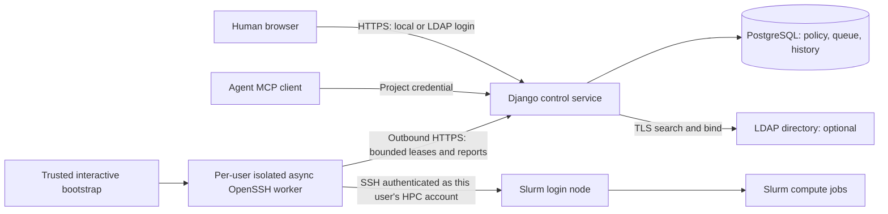

# Shared service: accounts, async connectors and key custody

Date: 2026-10-22. Status: implementation specification, not shipped hosted support.
Decision: [ADR 0005](adr/0005-hosted-identity-and-connectors.md).

This refines the existing architecture for a shared lab service. It follows the
user-supplied HPC MCP proposal's separation of application, agent and HPC
identities. It retains Django, the transactional ledger, immutable review
packages and the worker boundary. It does not require a FastAPI rewrite or a
REST service on either cluster.

Clarification, 2026-10-22: **OpenSSH workers are the required HPC access path.**
Each person uses their own account on each HPC. "Connector" below means that
person's OpenSSH worker, not a replacement for SSH or a shared cluster login.
Local/LDAP authentication identifies the broker user; it never substitutes for
authentication to that user's HPC account.

## 1. Deployment and credential boundaries

The hosted control service has no SSH private-key uploads, private-key database
columns, decrypted-key cache, user SSH-agent mount or multiplex socket mount.
Its image does not contain an SSH client. Central LDAP lookup credentials,
database credentials and TLS keys are separate service secrets, not HPC user
credentials. Job packages and audit records never carry those secrets.
The worker image does contain OpenSSH and invokes it for discovery, staging,
submission, monitoring, cancellation and collection. The restriction concerns
credential custody in the control service, not whether workers use SSH.

One connector security domain binds one application owner and one HPC principal
(cluster plus verified remote account). Separate processes alone are insufficient:
hosted session connectors use distinct Unix identities or equivalent isolation
with disjoint files, runtime sockets and journals. A container name or different
directory under a shared UID does not provide this boundary. Containers have no
Docker socket, host home mount, shared SSH-agent mount or privileged runtime.
The deployment supervisor is an administrator-controlled component, never an
agent endpoint or a function of the ordinary web process.

Application/agent keys grant project operations. Connector credentials grant
only the assigned connector's lease/report API. Neither credential is an SSH
identity. Connector credentials remain one-time-issued and hash-only in control;
hosted enrollment adds finite expiry, rotation and explicit principal bindings.

## 2. Three identities, with user-bound HPC execution

| Identity | Meaning | Must not imply |
| --- | --- | --- |
| Application user | Person authenticated by a local password or a directory | An HPC account, cluster access, or administrator rights |
| Agent credential | Named, scoped project access bound to its issuing user | Human login, approval authority, or another project member's HPC identity |
| HPC principal | Verified remote identity on one cluster | Permission for every project member to submit as that identity |

Submission authorization resolves project key, its bound application user, project
membership and that user's permitted HPC connection before reserving resources.
Repeat the relevant checks at dispatch. Enforce
`credential.issued_by == connection.owner == principal.owner == worker.owner`.
The worker additionally binds the verified remote account and cluster. Project
ownership is not the execution identity, and an agent cannot supply a different
user, SSH identity or worker to override this chain. Account impersonation and
cross-user HPC delegation are outside the initial shared-service scope.

For example, Alice and Bob can share a project and its compute allowance while
submitting under different HPC accounts:

| Request | Worker routing | Cluster execution identity |
| --- | --- | --- |
| Alice's project API key | Alice's worker for cluster A | Alice's verified account on A |
| Bob's project API key | Bob's worker for cluster A | Bob's verified account on A |
| Alice's project API key targeting cluster B | Alice's worker for cluster B | Alice's verified account on B |

Each person creates their own user-bound keys within a project they may submit
to. A project administrator may revoke keys and set project policy, but cannot
change a key's bound user or route a job through another person's HPC account.
Only the bound user may issue or rotate/reveal that user's execution keys;
allowing an administrator to rotate Bob's key and see its replacement would
give that administrator Bob's submission authority. Rotation preserves the
bound user. Recovery revokes access and requires the owner to re-enroll rather
than revealing an impersonation credential to another project member.
An HPC username may differ from the local/LDAP login and from that person's
username on another cluster. Keep these mappings explicit and verified.

Keep the existing UUID `User`, `Project`, `Membership`, jobs and ledger. Add the
following concepts incrementally; these are proposed tables, not current models:

| Entity/change | Important fields and constraints |
| --- | --- |
| `AuthenticationProvider` | UUID, type `local`/`ldap` (future `oidc`), stable provider key, enabled; LDAP secrets referenced outside DB |
| `AuthenticationIdentity` | User, provider, immutable external subject, login label, enabled, last verification; unique `(provider, subject)` |
| User security state | `auth_epoch`, local-login eligibility and active flag; directory-only users have an unusable Django password |
| `DirectoryEntitlement` | Identity, directory group subjects, checked-at, valid-until, generation; source-specific membership grants |
| `HPCPrincipal` | Owner, cluster, claimed remote name, verified name/numeric UID and cluster identity, proof timestamp, state; claimed and verified values distinguished |
| Connector binding | Existing worker identity plus principal, deployment kind, credential expiry/revocation and isolation attestation; separate public metadata from protected runtime config |
| `HPCSession` | Principal, connector, generation, state, reason, started/last-seen/absolute-expiry; no key, password, agent path or control socket in central records |
| Agent attribution | Add immutable `issued_by` and key generation; connection, principal and worker owner must match that user; jobs retain submitting credential, application actor, approving actor and execution principal |
| Durable work | Operation kind, attempt/principal/session binding, lease generation, deadline, retry/backoff and fair scheduling key |

HPC verification is a fixed read-only helper over a pinned authenticated target
that reports the effective remote account/UID and cluster identity. It is not
proof merely to type a username into the portal. Bind the result to a short-lived
enrollment challenge and the authenticated connector. This trusts the configured
cluster and approved connector; it is not remote attestation against a malicious
connector owner. Unexpected UID/cluster changes require new verification.

Discovery snapshots may be shared as non-secret cluster metadata. Connections,
sessions, environment recipes and storage paths retain their principal binding;
one user's successful SSH authentication never makes another user's connection
ready. Two people using the same remote UID do not gain workload/filesystem
isolation from this service. Detect and require explicit site approval for such
bindings rather than treating them as independent tenants.

## 3. Local and LDAP authentication

Retain Django authentication/session primitives. Introduce an explicit provider
choice or deployment-selected provider. Do not install an unrestricted chain of
LDAP followed by a same-username local fallback. Directory rejection or outage
must never authenticate that directory identity using a leftover local password.
An account with multiple login methods requires an explicit audited identity
link; matching an email, username or LDAP DN is not enough.

### Local accounts

- Use Django password APIs and an Argon2id-first hasher configuration; retain
  PBKDF2 verification for existing hashes and upgrade on successful login.
  Tune hashing against the actual server and bound login concurrency.
- No plaintext/reversible password storage, password logging, public unrestricted
  sign-up or password-setting through agent tools. Use invitation or operator
  enrollment and a tested one-time reset process before public access.
- A separately named local recovery administrator may remain enabled with
  explicit access policy. Recovery login is a deliberate provider selection,
  not automatic fallback when LDAP fails.

Django already supplies salted adaptive hashing and a hasher migration path.
[Django password management](https://docs.djangoproject.com/en/5.2/topics/auth/passwords/)

### LDAP accounts

Use `django-auth-ldap`/`python-ldap` behind a small project adapter that owns
provider routing and stable subject mapping. Do not reimplement LDAP bind or
password verification. The package's default username-based user construction
needs an override for this identity model. LDAP-only users receive an unusable
local password. The package documents that adding a usable local password with
`ModelBackend` can otherwise bypass directory rejection.
[LDAP user mapping](https://django-auth-ldap.readthedocs.io/en/stable/users.html)

Perform a bounded search then user bind over verified LDAPS or required StartTLS.
Reject empty passwords, zero/multiple search results, TLS validation failures,
timeouts and unsupported referrals. Escape LDAP filters/DNs using the library.
The user password exists transiently during login and is never persisted in
sessions, task payloads or diagnostics. If lookup needs a bind account, use a
read-only service identity from a mounted secret file, with explicit search
bases and CA configuration. No plaintext fallback is permitted.
[LDAP search/bind](https://django-auth-ldap.readthedocs.io/en/stable/authentication.html)

Choose an immutable directory subject per deployment: for example OpenLDAP
`entryUUID` or AD `objectGUID`, normalized with its type and provider namespace.
Do not use a mutable DN, login name or email as that subject. If the directory
cannot supply a trustworthy stable identifier, stop automatic provisioning and
require an administrator-approved mapping. Directory renames retain the same
User UUID; deletion/recreation with a new subject creates a different identity.

These identifiers are specified by the directory systems rather than inferred
from their display names.
[LDAP entryUUID](https://www.rfc-editor.org/rfc/rfc4530.html),
[AD object identity](https://learn.microsoft.com/en-us/windows/win32/ad/object-names-and-identities)

Group mappings are explicit allowlisted rules to source-specific project roles.
No directory group implicitly grants global administration or an HPC account.
Removing an LDAP-derived grant does not erase unrelated manually granted roles,
but disabled/denied identities take precedence over every role. Group refresh
must also detect directory account disablement/deletion and login-group removal.
Track operator suspension separately from directory status so a successful
directory refresh cannot reactivate an account an administrator suspended.
LDAP I/O runs before the short identity-update transaction, never while holding
project/budget locks; unique subject constraints fence concurrent first logins.

### Session lifetime, deprovisioning and agent keys

Use HTTPS, secure/HTTP-only cookies, CSRF protection, session rotation and idle
plus absolute expiration. Add bounded per-source and per-provider/account login
rate limits without an easy permanent account-lockout denial of service.
Responses do not enumerate directory accounts or disclose raw bind errors.

Login and privileged mutations require fresh directory entitlement. A proposed
default validity is five minutes, configurable downward; deprovisioning takes
effect within that explicit bound, not instantaneously. Refresh before expiry
with a bounded background task. When freshness expires during an outage, block
new login, admission, approval, account binding and dispatch for affected identities;
do not invent fresh entitlements. A local authenticated administrator retains
the explicit recovery path.

Increment `auth_epoch` on suspension/revocation and recheck it for human sessions
and privileged operations. Bind project keys to their issuing user and check
current issuer status/roles rather than treating an unexpired random string as
perpetual directory authorization. Disabling a user blocks their keys and new
work through their principals; it does not revoke unrelated users' keys or
silently delete a shared project's history. Ownership transfer is explicit.

Removing authority blocks new work, including admitted but undispatched jobs.
Previously dispatched jobs retain an accounting-only reconciliation path under
connector/system authority; that path cannot submit new jobs or expose outputs
to a revoked user. Cancellation and session closure are separate audited actions:
closing an SSH session does not cancel a Slurm job. A global suspension screen
must make this distinction visible.

## 4. SSH custody and session activation

### Supported target modes

| Mode | Where authentication capability lives | Hosted policy |
| --- | --- | --- |
| Isolated server session | In a per-principal connector's live SSH transport/control socket | Preferred server option only after site approval, isolation and a real keyless bootstrap mechanism pass acceptance |
| Personal outbound connector | On the user's protected device/service identity | Supported initial route when server bootstrap is unavailable; private keys never uploaded centrally |
| Delegated HPC API | Site-issued delegated credential in its own connector boundary | Future adapter, requiring administrator-supported delegation |
| Central private-key vault or shared user's `.ssh` | Broker/runner server disk or general shared runtime | Rejected for the shared-service design, even if keys are encrypted at rest |

For server sessions, configure `session_only`: consume an already authorized
transport and fail closed if it is gone. Do not fall back to identity files,
ambient SSH agents, default home/config files or silent authentication. Pin host
keys, prohibit forwarding and raw SSH APIs, and isolate each control directory.
The current `mfa` transport's failing fallback route is useful groundwork, but
does not establish hosted session isolation or provide interactive bootstrap.

**Bootstrap must be concrete.** A workstation's SSH session/control socket cannot
simply be copied to a server to create a new authenticated outbound connection.
The attachment's "local helper supplies authentication" is an interface
requirement, not an implemented mechanism. Establishing a server-resident
transport needs a site-approved means of completing authentication there without
retaining the user's private key. Hardware-backed/short-lived delegated
authentication or a tightly constrained bootstrap signing relay could be
evaluated. Such a relay is access to a signing capability and needs its own
review; ordinary SSH-agent forwarding is disabled in the baseline, including
bootstrap. Do not advertise the central mode as usable until its mechanism and
interactive Cisco/MFA flow have actually been tested.

The deployable fallback keeps the authenticated SSH transport on the personal
connector and uses its outbound HTTPS control connection. The device must remain
available for new operations; accepted Slurm jobs continue if it sleeps. A
private key readable by the desktop/agent's Unix user is not protected merely
because another Python process uses it. Use a separate protected identity/device
or a separately assessed hardware credential and trusted activation flow.

Control sockets and signing agents are credentials in effect: isolation limits
which processes can use them, but a host administrator/root can still access
server-resident capabilities. Keeping private keys off the broker reduces key
exfiltration and credential reuse risk; it does not make an actively authorized
session safe against compromise of its connector or privileged host.
OpenSSH documents both connection sharing and the risks of agent forwarding.
[OpenSSH client configuration](https://man.openbsd.org/ssh_config),
[OpenSSH client](https://man.openbsd.org/ssh)

Record session absolute expiry, not only `ControlPersist` idle behavior. On
expiry/revocation, stop admission/dispatch, close/reap the master through the
isolated supervisor and require trusted user reconnection. Runtime state and
sockets are ephemeral; restarts cannot restore an authenticated session from a
database flag. Revocation has an observable completion state and failure alarm.

No broker LDAP login establishes HPC authentication. For the university cluster,
Cisco second factor occurs during SSH login and remains an interactive site
step. No REST capability, site session-reuse permission or admin installation
permission is assumed. Never run a daemon on an HPC login node without approval.

## 5. Async execution without weakening transactions

Two properties are required: durable asynchronous jobs and nonblocking network
I/O. The existing lease/outbox and worker journal provide part of the first.
The current serial `Worker.poll_once`, synchronous HTTP client and
`OpenSSHTransport._run` still need an async implementation for the second.

Keep Django and introduce an async backend/transport contract for discovery,
submission, reconciliation, observation, cancellation, usage and bounded output
collection. Use `asyncio.create_subprocess_exec` to run the fixed system OpenSSH
client, preserving its site/MFA behavior and existing helper protocol. An
AsyncSSH rewrite is not needed to make SSH I/O asynchronous. Keep pure rendering
and validation independent from I/O.
[Python async subprocess API](https://docs.python.org/3.13/library/asyncio-subprocess.html)

The async worker uses a bounded HTTP client, structured task ownership, separate
stdout/stderr drains, input backpressure, operation deadlines and cleanup that
reaps subprocesses after timeout/cancellation. Reader buffer limits alone do not
bound total output: retain explicit total-byte limits and bounded transfers.
Large parsing/hashing and journal fsync must not stall the event loop; use
bounded file/executor work while preserving durable intent-before-side-effect.
Do not implement the final design by wrapping the entire serial worker in an
unbounded thread pool. Optional storage/environment/workflow hooks adopt the
same async contract without importing controller/ORM code into a connector.

Start conservatively with one submit/reconcile mutation at a time per principal,
and configurable bounded metadata concurrency. Separate principals can progress
concurrently. Add global, per-cluster, per-principal and per-project limits,
fair scheduling and exponential backoff with jitter. Prioritize cancellation
and uncertain-submission reconciliation so new requests cannot starve recovery.
Batch scheduler observations where supported; no job launches an unrestricted
independent polling loop. Fairness is persistent policy, not just an in-process
semaphore. Semaphores protect process capacity; DB leases and journal fencing
protect uniqueness across processes and restarts.

On control:

1. Short transaction checks permissions, reserves compute and commits the durable
   work item. A crash after commit cannot lose work or spend twice.
2. A connector takes a short lease outside the request's job-submission lifetime.
3. Network and filesystem work run outside DB locks.
4. A short report transaction checks current lease/generation and applies the
   observation/settlement idempotently.

Keep accounting/authorization transactions as synchronous service functions.
Async endpoints call each whole transaction with `sync_to_async` rather than
awaiting between row locks. Django 5.2 explicitly documents that transactions
are not supported directly in async mode. ASGI can host async status/long-poll
routes; ordinary management views need not all be converted. Use supported
database pooling and disable persistent per-request connections in ASGI mode.
[Django async support](https://docs.djangoproject.com/en/5.2/topics/async/)

### Authentication loss, leases and uncertain submission

Session availability is orthogonal to the durable job/accounting state. Present
"Waiting for HPC authentication" without replacing or losing an attempt's state.
Use separate reasons for expired authentication, network unreachability, host-key
failure and scheduler failure. Do not parse arbitrary SSH stderr into public UI
messages. Known expired-session state comes from the connector's trusted session
registry; ambiguous transport failures remain unknown/unreachable.

If no submission intent or remote side effect exists, a queued operation may
wait for reconnection with a deadline. An already admitted waiting attempt keeps
its existing reservation and lifetime slot; reconnecting does not create another
attempt. Release only with durable proof that submission never began. Recheck
grant/credential/account authority before eventual dispatch.

After dispatch intent, timeout, task cancellation or SSH loss means possible
acceptance until reconciled. Killing local `ssh` does not prove `sbatch` failed.
Keep the reservation and native correlation marker; never resubmit just because
a task/lease expired. Cancellation of a Python task is also distinct from a
requested, confirmed Slurm cancellation.

Renew leases during bounded long operations. Lease expiry, renewal and reports
are fenced by owner/generation. A stale task cannot overwrite newer state or
start another submission. Bind new dispatch to principal, session generation
and authorization epoch; reconnection can reconcile old jobs only under the
same verified HPC identity. A changed cluster/account is a new binding, not
recovery. Dispatch permission and intent are durable before any remote side
effect; reconnection is never an excuse to erase that uncertainty.

## 6. PostgreSQL and migration

LDAP does not itself require a database change. The current schema already has
multiple users/projects and Django local password hashes. Nevertheless, use
PostgreSQL for the shared service and its integration tests now: concurrent web
requests, directory refresh, connectors and queue consumers need tested row-lock
semantics. SQLite remains an explicitly supported personal/development profile,
with its existing short `IMMEDIATE` transactions; do not pretend its
`select_for_update` is equivalent.

Use the same Django models/migrations and domain services. Add optional
`psycopg` dependencies and explicit settings for each backend; SQLite-only
transaction options must not reach PostgreSQL. Keep PostgreSQL on private
networking with a least-privilege runtime role and separate migration ownership.
Place DB/journal/object storage on suitably managed server storage, not casually
on the shared research NAS whose exhaustion can take down LDAP and homes.

Audit every existing `select_for_update().select_related(...)`: PostgreSQL may
lock joined rows or reject locks across nullable joins, unlike current SQLite
tests. Establish one documented lock order for users/authorization, project,
grant, connection/principal, attempt and storage; retry whole short transactions
only for known serialization/deadlock failures with bounded backoff.
Use `SKIP LOCKED` for queue claims after correctness tests, never to skip budget
or permission rows. Add due-work/lease indexes and bounded queue queries before
multiple consumers. PostgreSQL documents `SKIP LOCKED` as appropriate to
queue-like work, with an inconsistent view unsuitable for general reads.
[PostgreSQL locking SELECT](https://www.postgresql.org/docs/current/sql-select.html),
[Django database differences](https://docs.djangoproject.com/en/5.2/ref/databases/)

Retain PostgreSQL as the authoritative queue/ledger initially. Redis/Celery is
not required for async SSH, and no message broker may become a second source of
funds or submission truth. Notifications can later wake consumers, but polling
must recover if notifications are lost.

Rehearse migration using a copied database and object store: pause admissions
and worker leases, reconcile all dispatched/uncertain attempts, take coordinated
backups, create schema, import preserved UUIDs/password hashes/ledger/journal
identities and verify counts, digests and balance invariants. Existing connector
tokens must not silently become hosted credentials; explicitly re-enroll into
verified isolated principal bindings and rotate credentials. Old connections
are marked legacy/unverified for hosted admission until mapped; historical
execution revisions are not rewritten. Pending prepared jobs need a new revision
if their execution binding changes.

Run one authoritative service after cutover. Rollback after any new submission
requires reconciliation of new records/native jobs, not simply starting the old
SQLite backup. New DB deployment is a separate cutover, not an automatic side
effect of enabling LDAP. This document does not migrate the running local portal.

## 7. Repository changes and implementation order

Use reviewable branches/commits per work package. Optional LDAP, supervisor and
future native APIs remain installable adapters, not mandatory personal-mode
dependencies. Authentication and authorization interfaces belong in core.

| Work package | Concrete repository changes | Completion gate |
| --- | --- | --- |
| MU-01 PostgreSQL baseline | Backend-specific settings, `postgres` dependency extra/lock, disposable PostgreSQL Compose service and CI matrix; audit transaction lock order and joined locks | Real independent-process admission/settlement/lease races pass on PostgreSQL and SQLite |
| MU-02 account providers | `control/identity/` models, provider router/local backend, optional LDAP adapter, login/provider UI, rate limiting, entitlement refresh and epoch checks; admin membership/account management | No LDAP/local collision or fallback; directory disablement revokes new authority within configured bound |
| MU-03 principals and connector authority | Split shared cluster metadata from each user's verified account connections; principal/session models, user-bound project keys, paired expiring OpenSSH worker credentials, migration and audit | Two users sharing a project/cluster execute as their own HPC accounts; actor/connection/principal/worker owner mismatches are rejected |
| MU-04 async connectors | Async transport/backend protocol and worker/client runner; bounded subprocess/streaming/journal work; async optional hooks and lease renewal | Slow/unreachable connection does not block another; timeout/cancel/crash never duplicates submission or refunds uncertainty |
| MU-05 isolated session deployment | Separate supervisor/packaging, per-principal runtime/UID, session-only transport, trusted activation and revocation UI; personal connector packaging in parallel | No server private keys/ambient agents; selected keyless bootstrap and actual Cisco session expiry/reconnect pass site acceptance |
| MU-06 hosted cutover | TLS/ASGI, secret mounting, backups/restore, observability, copied-data import rehearsal and legacy binding quarantine | One authoritative ledger; upgrade/rollback and recovery tested before allowing shared lab access |

Do MU-01 and MU-02 first; principal bindings must be designed before the async
worker can route concurrent users. MU-05 central activation is blocked on a real
site-supported bootstrap mechanism, not on an assumed feature of ControlMaster.
The personal connector provides progress without weakening key custody.
Future site-delegated APIs and HTTP MCP OAuth are separate adapters/contracts;
LDAP browser login alone does not implement MCP OAuth.

## 8. Required integration and failure tests

Use disposable local users, LDAP directory, PostgreSQL and fake/Slurm fixtures.
No institutional keys, LDAP passwords or unattended real compute in ordinary CI.

| Test | Required evidence |
| --- | --- |
| MU-AUTH-01 | Local hashes verify/upgrade; invalid/empty passwords, disabled users, rate limits and reset replay handled; secrets absent from logs/DB/session payloads |
| MU-AUTH-02 | LDAP trusted TLS bind succeeds; bad CA, cleartext fallback, bind timeout, empty/multiple results and filter injection rejected |
| MU-AUTH-03 | Same username/email in local and LDAP never merges or falls back; rename retains identity; recreated LDAP subject cannot inherit old jobs/permissions |
| MU-AUTH-04 | Directory disable/group removal, expired freshness, existing browser session, old API key and already leased submission cannot authorize new work |
| MU-AUTH-05 | Recovery admin is deliberately selected; LDAP outage never selects it automatically; source-derived roles remove correctly without dropping manual grants |
| MU-ISO-01 | User A cannot claim/use user B's HPC connection, worker token, socket, journal or private remote paths; mixed-owner worker profiles rejected. Project artifact sharing follows explicit project permissions and never grants access to another user's SSH account. |
| MU-ISO-02 | Control container/UID cannot read private keys or access user agent/control sockets; no agent/Docker socket mounts; connector A cannot access connector B's runtime |
| MU-ISO-03 | Session-only mode never opens a fresh authenticated connection when master is missing or dies after precheck; no inherited `SSH_AUTH_SOCK`, config, identity, proxy or forwarding fallback |
| MU-ISO-04 | Claimed remote user/host/UID mismatch, stale enrollment challenge, session generation replay and actor/connection/principal/worker owner mismatch rejected |
| MU-ISO-05 | Alice and Bob share one project and cluster definition but use separate keys/workers/HPC accounts; scheduler and output provenance identify the correct account. Project ownership, human approval, key rotation and forged target fields cannot switch the execution user. An administrator cannot obtain another user's execution key by rotating it. |
| MU-IO-01 | Concurrent slow and healthy connectors demonstrate bounded overlap, fair queue service, capped scheduler polling and bounded RAM/FD/subprocess counts |
| MU-IO-02 | Large stdin plus stdout/stderr floods and task cancellation drain or terminate/reap without deadlock; event loop remains responsive during journaling/hashing |
| MU-IO-03 | Kill before intent, after intent, after remote acceptance and before report; journal restart and lease expiry/renewal preserve exactly one logical submission and correct reservations |
| MU-IO-04 | Expired SSH session pauses new work; accepted job continues; reconnect restores only same-principal reconciliation; output access remains revoked after user disablement |
| MU-DB-01 | Independent PostgreSQL processes race admission, approval consumption, lifetime limit, rotation, lease claim, cancellation and settlement; no overspend, duplicate lease or double refund |
| MU-DB-02 | Joined/nullable row locking, deadlock retry, queue contention and directory-revocation/dispatch races exercise actual PostgreSQL semantics |
| MU-DEP-01 | Copy/import retains all UUIDs, balances, hashes, decisions and objects; stale old service cannot admit; restore starts paused and reconciles before any new submission |
| MU-SITE-01 | Explicit operator acceptance on each cluster: keyless activation mechanism, Cisco/MFA, reuse permission, absolute expiry, revoke/close, restart and network loss; no login-node daemon assumed |

The initial security guarantee remains bounded: project policy governs broker
operations, not every action possible under a remote Unix account. Arbitrary
approved job code can access that account's files or submit outside the broker
unless the cluster enforces additional restrictions. Separating private keys,
connectors and human identities is necessary, but not a claim that a compromised
central authority, connector administrator or shared HPC UID is harmless.
