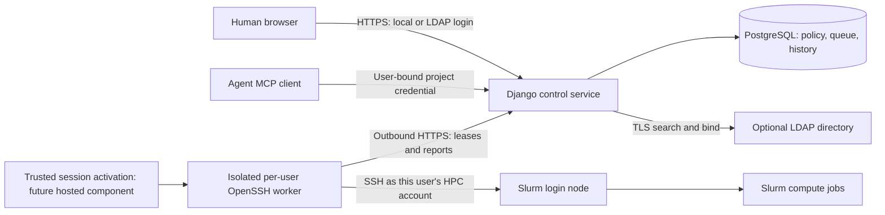

# Shared service: accounts, async connectors and key custody

Date: 2026-10-22. Status: implemented shared-service foundations; protected hosted
deployment remains unaccepted. Decision: [ADR 0005](adr/0005-hosted-identity-and-connectors.md).

The broker retains Django, its transactional ledger, immutable review packages
and the OpenSSH worker boundary. A shared service does not require a FastAPI
rewrite or a REST service on either cluster. Local/LDAP login identifies a broker
user; authentication to that person's HPC account remains a separate SSH step.

| Area | Implemented | Remaining before the protected hosted target |
| --- | --- | --- |
| Database | SQLite default, explicit PostgreSQL configuration, real concurrency regressions, offline transfer and copied-data rehearsal | Production database operations, full disaster recovery and hosted cutover acceptance |
| Human identity | Explicit local/LDAP routing, stable directory identities, bounded cached authority, synthetic TLS fixture | Institutional policy acceptance, membership UI, directory-derived project roles, login rate limiting and OIDC |
| Execution authority | Issuing-user-bound project keys; matching connection/worker ownership; current eligibility and role checks; one-use expiring personal connector pairing | Verified remote-principal/session records, isolated connector supervision and expiring worker credentials |
| Concurrency | Opt-in bounded asynchronous core Slurm worker | Async extension hooks, broader scheduler fairness/batching and hosted performance acceptance |
| Deployment | Native and disposable container fixtures | Protected installer, independent approval channel and a site-approved keyless server-session bootstrap |

See [runtime scope](runtime.md), [database migration](database-migration.md), the
[synthetic LDAP/TLS fixture](../deploy/ldap/README.md) and [async workers](async-workers.md)
for implemented interfaces and evidence. The remaining requirements below are
not claims that these fixtures establish production isolation.

## 1. Deployment and credential boundaries

The protected deployment target is:

The control service accepts no SSH private-key uploads and has no private-key
database columns or user SSH-agent/control-socket mounts. The control Docker
target has no SSH client; the worker target includes OpenSSH. Directory lookup
credentials, database passwords and TLS keys are separate service secrets, never
job payloads or agent credentials.

The protected target assigns separate Unix identities or equivalent isolation
to different users' connector runtimes, sockets, files and journals. Processes,
directories, owner lanes and container names under a shared UID do not establish
this boundary. Containers must have no Docker socket, shared SSH-agent mount or
unrestricted host home mount. An administrator-controlled supervisor, independent
of agent-writable code and configuration, remains to be implemented and accepted.

Project credentials authorize project operations; worker credentials authorize
only scoped lease/report operations. Neither is an SSH identity. Worker tokens
are already issued once and stored as hashes. Automatic expiry, rotation policy,
remote-principal proof and isolation attestation are future hosted enrollment
requirements, not properties implied by the current token format.

## 2. Three identities and current ownership checks

| Identity | Meaning | Does not grant |
| --- | --- | --- |
| Application user | Person authenticated locally or by a directory | An HPC account or administrator rights |
| Agent credential | Scoped project access bound to its issuing user | Human approval or another member's HPC identity |
| HPC principal | Remote account on a particular cluster | Access for every member sharing the broker project |

Current authorization checks the issuing user's eligibility and project roles,
then requires an enabled, complete connection and unrevoked worker satisfying
`credential.issued_by == connection.owner == worker.owner`. Dispatch repeats the
authority checks under transaction locks. Agents cannot override this chain by
supplying a different actor or SSH identity. Project ownership alone does not
determine the execution account.

Alice and Bob may share a project allowance while using separate user-bound
keys, connections and workers. Only a key's issuer can rotate and reveal its
replacement; a project administrator can revoke or restrict access but cannot
obtain Bob's execution authority through rotation. Current membership and
cross-member project-resource grants require reviewed operator management;
there is no complete membership-management UI. Account impersonation and
cross-user HPC delegation are outside the initial scope.

The schema and the remaining design must be distinguished:

| Concept | Current representation and remaining work |
| --- | --- |
| Authentication provider | Protected provider configuration, including stable provider IDs and secret references; no provider-management DB/UI |
| `AuthenticationIdentity` | Implemented unique provider/immutable subject binding, enabled/directory state, verification time and configuration fingerprint |
| User security state | Active flag and local-login eligibility implemented; directory-only accounts have unusable local passwords; `auth_epoch` remains future work |
| Directory eligibility | Bounded cached group/account eligibility implemented; source-specific project-role grants and `DirectoryEntitlement` records remain future work |
| Worker and key ownership | Worker owner/profile scope and immutable key `issued_by` implemented; worker credential expiry and explicit remote-principal/session models remain future work |
| Durable execution | Attempt leases, generations, submission journal and native-identity fences implemented; hosted session-generation binding and isolated supervision remain future work |

The future `HPCPrincipal` enrollment must verify the effective remote account/UID
and cluster through a fixed read-only helper on a pinned target, bound to a
short-lived challenge. A typed username or ordinary resource discovery is not
that proof. The future `HPCSession` records availability and absolute expiry,
without putting private keys, agent paths or control sockets in central records.
Those models and their acceptance are not implemented by current ownership checks.

Shared non-secret cluster metadata must not make another user's connection ready.
Environment recipes and working paths stay bound to their connection. Two users
sharing a remote Unix UID do not gain remote workload/filesystem isolation from
separate broker records; that deployment needs explicit site approval and
additional restrictions.

## 3. Local and LDAP authentication

`IdentityRoutingBackend` is the sole Django backend. Provider selection is
explicit, with local login as the default when no directory configuration is
installed. Directory rejection cannot fall through to a local account with a
matching name. Matching email, login name or DN never links two identities.

Local accounts use Django password APIs and the configured PBKDF2 hasher. Existing
hashes are preserved during migration. Argon2-first tuning, a public-facing reset
process and bounded login rate limiting remain deployment work; the optional
Argon2 dependency does not mean that policy is configured. There is no unrestricted
public signup or agent password-setting endpoint.

The optional `ldap3` adapter performs bounded search and user bind over verified
LDAPS or required StartTLS. It rejects empty passwords, ambiguous search results,
untrusted TLS and unsupported referrals. Provider ID plus canonical `entryUUID`
is the implemented stable external subject; an AD `objectGUID` adapter would
need a separately tested contract. First LDAP login creates a distinct account
with an unusable local password and no project, worker or HPC grants. The login
password is transient and is not persisted in sessions, tasks or diagnostics.

See [identity configuration](../src/compute_broker/control/identity/README.md) for
protected provider/CA/lookup-secret configuration. The [TLS directory fixture](../deploy/ldap/README.md)
uses generated synthetic users and tests trusted LDAPS/StartTLS, rejected CA or
hostname mismatches, provider collisions and expired/disabled authority. It is
not evidence that a particular institutional directory policy has been accepted.

Cached eligibility lasts at most 300 seconds, configurable downward. Login,
human mutations, project key authority and dispatch fail closed when verification
expires or access is withdrawn. An optional protected refresh process performs
directory I/O outside database transactions, then updates identity state under
short locks. Outages cannot manufacture freshness or clear operator suspension.
Current checks support configured POSIX group membership, Samba account flags
and shadow expiry. Automatic group-to-project role mapping is not implemented.

Django session and CSRF protections remain in use. Changing the configured
authentication backend path requires browser sign-in again, even if database
transfer preserves session rows and the Django secret. Production HTTPS/cookie
policy, session absolute-expiry administration, reset/recovery operations and
rate limiting still need acceptance. OIDC and HTTP MCP OAuth are future adapters;
an LDAP browser login does not implement agent OAuth.

Disabling a user blocks new authority through that user's keys and admitted but
undispatched jobs. Already dispatched jobs retain worker/system observation and
accounting so disabling the user cannot erase spending. That reconciliation
does not grant new submissions or return artifacts to a revoked user. Cancellation
and SSH session closure remain separate actions; a full suspension-management
screen is future work.

## 4. SSH custody and session activation

| Mode | Authentication capability | Status |
| --- | --- | --- |
| Personal outbound connector | Local key and terminal-authenticated SSH master | Automatic pairing and interactive startup implemented; protected OS installation still requires acceptance |
| Isolated server session | Per-user connector's live SSH transport/control socket | Needs keyless activation, supervisor/isolation and real site acceptance |
| Delegated HPC API | Site-issued scoped credential in its own boundary | Future backend |
| Central private-key vault/shared `.ssh` | User private keys on the hosted broker/runner | Rejected for this shared-service design |

The [personal connector](personal-connectors.md) establishes its local master
through an interactive OpenSSH login, then pairs automatically using the human's
one-use setup download. Normal termination, revocation response and its absolute
session deadline close the owned master. Resume uses the saved worker identity
and journal; it does not mint another worker. SIGKILL and host failure still need
trusted local recovery. Keys and MFA responses never pass through control.

The MFA transport reuses a protected OpenSSH master and fails closed if
it is missing or dead, rather than initiating a fresh interactive login. It pins
host keys and disables ambient agents, forwarding and default key/config
fallbacks. This provides transport groundwork; it does not implement the proposed
hosted `session_only` profile, trusted activation service or per-user supervisor.

A workstation's control socket cannot be copied to a server to establish a new
outbound connection. Server-side activation needs a site-approved method that
does not retain the user's private key. Hardware/delegated authentication or a
constrained bootstrap signing relay could be evaluated, but none is an accepted
broker feature. Ordinary SSH-agent forwarding remains disabled. The university's
Cisco second factor is an interactive SSH-login step; synthetic fixtures do not
accept its activation, expiry or reconnect behavior.

The personal-worker target keeps SSH capability on the protected device and
uses outbound HTTPS for control. Accepted Slurm jobs can continue while that
device is unavailable, but new dispatch requires online control confirmation.
Another process or Docker container under the desktop agent's effective control
does not protect its keys. A host administrator can use server-resident session
capabilities even when private keys are absent.

The future supervisor must enforce absolute session expiry, close/reap masters
on revocation and show completion/failure. `ControlPersist` idle behavior alone
is not an absolute authorization lifetime. Restarts cannot restore authenticated
state from a DB flag. No broker LDAP login establishes HPC authentication, and
no daemon on a cluster login node is assumed.

## 5. Implemented async worker and remaining scale work

The default runner is synchronous. `BROKER_WORKER_ASYNC=1` selects the optional
core Slurm runner using `AsyncJsonClient`, `AsyncSlurmBackend` and
`AsyncOpenSSHTransport`. Fixed OpenSSH subprocesses and HTTP streams use bounded
async I/O; the runner is not a thread-pool wrapper around the serial loop.
See [async workers](async-workers.md) for configuration and limits.

Submission, reconciliation, observation, cancellation, bounded collection and
discovery share the existing package/helper/accounting contracts. Total output
limits, input backpressure, operation deadlines, process-group termination and
child reaping bound network operations. Small local validation and journal
read/write/fsync operations remain synchronous; arbitrary network filesystems
or large Python work can still stall a process.

The protected owner registry and per-owner lanes allow one operation per owner,
with bounded global active/waiting work and registered owners. They coordinate
one process, not distributed spending. DB leases, generation checks and durable
journals remain authoritative across processes. The async runner rejects enabled
extensions and advertises none; storage, environment and workflow hooks still
use synchronous workers. Async plugin hooks, more scheduler batching, persistent
multi-cluster fairness and deployment performance tests remain future work.

Control transactions remain synchronous: check authority/reserve/commit work,
perform remote operations outside DB locks, then apply a fenced report in a short
transaction. An ASGI/async-view conversion is not required for the worker and is
not implemented by switching runner mode.

After durable dispatch intent, timeout, task cancellation or SSH loss leaves
possible remote acceptance. The journal retains the attempt and reservation;
recovery reconciles rather than repeating `sbatch`. A saved receipt survives a
lost report, and output failure does not suppress valid accounting. Cancelling a
local Python task is not confirmed Slurm cancellation. Bounded operations and
generation-fenced reports are implemented; automated lease renewal and binding
dispatch to a future verified session-generation registry remain additional work.

## 6. PostgreSQL and offline migration

SQLite remains the default development/personal database with short `IMMEDIATE`
transactions. PostgreSQL uses the same models/migrations and explicit row locks;
SQLite's `select_for_update` behavior is not equivalent. Install the `postgres`
extra and use explicit database settings, a private password file and verified
TLS as described in [runtime configuration](runtime.md). DSNs and inline password
environment variables are refused. A disposable PostgreSQL Compose fixture is
available; it is not a complete production DB deployment.

PostgreSQL regressions exercise independent transactions/processes, joined and
nullable locks, admission, leases, cancellation, authority changes and storage
reservations. Authorization serializes user/identity, worker, project, grant,
connection, credential and attempt checks; storage operations preserve project
before global-pool lock order, including when nested in idempotent requests.
This is evidence for tested races, not a claim that every workload or deadlock
path has been accepted. Automatic deadlock retry, broader queue batching and
production connection-pool policy remain work to validate.

PostgreSQL remains the authoritative queue and ledger. Redis/Celery is not needed
for async SSH and must not become another source of compute funds or submission
truth. Production operation still needs private networking, appropriate runtime
and migration roles, protected backups and storage capacity independent of an
exhaustible research home/share.

The [offline migration tools](database-migration.md) implement export, import,
verification and copied-SQLite rehearsal. Stop writers, pause admission/leases,
resolve uncertain or unsettled work, retain an immutable source backup and
migrate an empty target before import. The tools preserve all model and through
records, UUIDs, password hashes, timestamps, decisions, ledger and artifact
metadata. Canonical per-table digests, relationship/count checks, balances and
retained object bytes must agree. Keep the original Django secret independently
protected. Session rows survive transfer, but a changed Django backend path
requires sign-in again.

Legacy keys gain issuing users only from recorded creation/rotation provenance.
Unknown owners are quarantined with revocation and an audit event. The separate
offline verification tool accepts an explicit private key-to-user mapping,
checks current roles/provenance and preserves previously revoked state; it never
infers ownership from a sole current member.

These tools do not change live configuration, link a local account to a directory
by name, or turn old workers into isolated hosted connectors. A protected hosted
cutover also requires explicit identity linking, connector re-enrollment and
acceptance of the new boundary. Run one authoritative DB after cutover. Once new
work has been admitted, rollback needs reconciliation of new records/jobs rather
than simply starting the old SQLite copy. Enabling LDAP does not migrate data.

## 7. Remaining work packages

Keep changes reviewable and optional adapters independently installable. The
implemented foundations permit testing the remaining gates; they do not remove
them.

| Package | Current foundation | Remaining completion gate |
| --- | --- | --- |
| MU-01 database | Backend configuration, disposable PostgreSQL, real concurrency tests and offline transfer | Hosted DB operations, recovery and performance acceptance |
| MU-02 accounts | Local/LDAP router, stable identities, TLS fixture and bounded freshness | Institutional eligibility policy, membership UI, project-role mapping, reset/rate-limit/session administration |
| MU-03 execution identity | Issuer-bound keys, ownership checks, one-time worker enrollment and legacy-key quarantine | Verified remote-principal/session records, expiring worker enrollment and isolated runtime attestation |
| MU-04 async connectors | Core Slurm HTTP/SSH async runner and bounded owner lanes | Async extensions, scale/fairness/batching and lease-renewal acceptance |
| MU-05 protected sessions | Fail-closed MFA transport reuse | Keyless trusted activation, per-user supervisor/UID isolation, actual Cisco expiry/reconnect acceptance |
| MU-06 hosted operations | Container fixtures and offline cutover rehearsal | Protected installer, TLS/service operations, independent approval channel, backup/restore and production acceptance |

MU-05 central activation depends on a real site-supported bootstrap mechanism.
A protected personal outbound worker is the alternative target, not a reason to
upload private keys centrally. OIDC, HTTP MCP OAuth and delegated scheduler APIs
remain separate future adapters.

## 8. Acceptance evidence and remaining tests

Existing automated evidence includes database configuration/concurrency/storage
tests, user execution-identity tests, identity unit tests, the synthetic LDAP/TLS
fixture, offline migration/legacy-owner tests and the async worker/transport
suites. Their fixtures use generated identities; ordinary CI needs no
institutional credentials or remote compute. See the linked feature guides and
[testing plan](testing.md) for commands and scope.

The following is a required hosted acceptance checklist, **not a list of features
or tests all completed**:

| Test family | Required additional evidence |
| --- | --- |
| Human identity | Institutional TLS/search/group/account policy; reset/rate limiting; no same-name merge/fallback; bounded disablement for existing sessions, keys and queued dispatch |
| Own-user execution | Two project members use their own verified HPC accounts; project ownership, approval or key rotation cannot switch execution identity; forged/stale enrollment proof rejected |
| Runtime isolation | Agent/control/worker A cannot use worker B's files, sockets or journal; no Docker/ambient-agent mounts; protected release/configuration cannot be replaced by the agent |
| Session lifecycle | Real keyless activation, Cisco MFA, approved reuse, absolute expiry, revocation, restart and network loss; missing master never authenticates afresh |
| Async scale/recovery | Bounded overlap and fairness under slow/unreachable clusters; floods/cancellation do not leak subprocesses; crash/lease recovery never resubmits an uncertain attempt or refunds it |
| PostgreSQL/recovery | More queue/authority/settlement contention, copied-data restore, storage exhaustion and rollback after new activity; one authoritative ledger throughout |
| Deployment | Production HTTPS/secrets/backup monitoring, membership administration and an approval channel independent of an agent-controlled desktop |

Project policy governs broker operations, not every action available to the
remote Unix account. Arbitrary approved code can access that account's files or
submit outside the broker unless the cluster enforces restrictions. Separating
keys and users does not make a compromised host administrator, central authority
or shared HPC UID harmless.
